# Aivenue

<p align="center">
  <a href="https://github.com/oscasrhiah/aivenue/releases/latest"></a>
  <a href="https://github.com/oscasrhiah/aivenue/releases"></a>
</p>

> **English summary** — Aivenue lets the subscription-based AI coding CLIs you already have (Claude Code, Codex, Antigravity, GitHub Copilot CLI, OpenCode, Qwen Code) work together in one workflow: one writes the plan and another reviews it, one implements and another verifies the code, looping until the reviewer approves. Any agent can hand sub-tasks to another vendor's CLI as a sub-agent. It runs locally as a desktop app (Windows, Linux) or a VS Code extension, uses your own accounts or API keys, and never handles your passwords. Licensed under MIT.

讓多家訂閱制 AI coding CLI 在同一個工作流裡分工合作：一家寫計畫、另一家審查，來回修改直到通過；接著實作，再由審查者驗收程式碼，直到通過為止。任何 agent 在工作中都能透過 Aivenue 把子任務派給其他家的 agent 當 sub agent。全程即時顯示每個 agent 讀了什麼、改了什麼、跑了什麼指令。

<p align="center">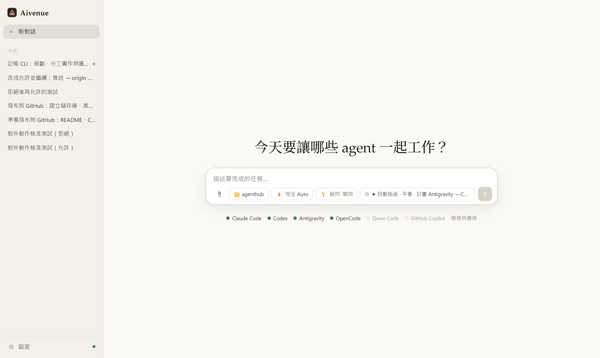</p>

### 示範影片

https://github.com/user-attachments/assets/79ea06a8-e697-43fa-b7f3-5c8199dd7ecb

<p align="center"><sub>影片約 1 分鐘，畫面加速播放：輸入任務 → Antigravity 額度用完、自動改由 Claude 寫計畫 → Codex 審查退回 2 個問題 → 第二輪通過 → Claude 實作並平行派出 OpenCode、Antigravity 兩個 sub agent → 審查者失敗時自動換 Codex 驗收 → 完成。</sub></p>

---

## 目錄

- [Aivenue 是什麼](#aivenue-是什麼)
- [支援的 AI 工具](#支援的-ai-工具)
- [下載與安裝](#下載與安裝)
- [快速開始](#快速開始)
- [實際範例：一個任務從頭到尾](#實際範例一個任務從頭到尾)
- [範例任務](#範例任務)
- [主要功能](#主要功能)
- [從原始碼建置](#從原始碼建置)
- [專案架構](#專案架構)
- [常見問題](#常見問題)
- [授權](#授權)

## Aivenue 是什麼

很多人同時訂閱了好幾家 AI coding 工具，但每一家都只能各做各的：要讓 Claude 寫、Codex 審，就得自己在兩個終端機之間複製貼上計畫和審查意見；單一模型自己寫自己審，也容易漏掉同樣的盲點。

Aivenue 把這些 CLI 串成一個工作流：

```
撰寫計畫 ⇄ 審查計畫（來回修改直到通過）→ 實作 ⇄ 審查程式碼（來回修正直到通過）
```

- **用你已經有的帳號**：各家 CLI 用自己官方的瀏覽器流程登入，Aivenue 不經手帳號密碼；也可以改用 API 金鑰。
- **不同家互相審查**：審查者預設一定和撰寫者不同家，降低同一個模型的盲點。
- **完全在本機執行**：Aivenue 只在 127.0.0.1 開服務（以隨機權杖保護），設定、對話紀錄與用量統計存在 `~/.aivenue/`（可用環境變數 `AIVENUE_HOME` 改位置）。
- **兩種外殼、同一套引擎**：桌面 App（Windows、Linux）與 VS Code 插件共用相同的引擎與介面。

## 支援的 AI 工具

至少要在這台電腦上安裝並登入一家。Aivenue 的「設定 → 供應商與帳號」對每一家都有「安裝」「登入」按鈕，會自動使用該平台的安裝方式；也可以自己在終端機執行下表的指令。

| 工具 | 訂閱登入 | API 金鑰 | 安裝指令 |
|---|---|---|---|
| Claude Code | Claude Pro / Max | Anthropic API | `npm install -g @anthropic-ai/claude-code` |
| Codex | ChatGPT Plus / Pro | OpenAI API | `npm install -g @openai/codex` |
| Antigravity（`agy`） | Google AI Pro / Ultra | — | Windows：`winget install --id Google.AntigravityCLI -e`<br>macOS / Linux：`curl -fsSL https://antigravity.google/cli/install.sh \| bash` |
| GitHub Copilot CLI | Copilot Pro / Pro+ / Business | 自帶金鑰（BYOK） | Windows：`winget install --id GitHub.Copilot -e`<br>macOS / Linux：`npm install -g @github/copilot` |
| OpenCode | 內建免費模型，另可接上百家 API 與訂閱方案（Kimi、通義、GLM、MiniMax…） | ✓ | `npm install -g opencode-ai` |
| Qwen Code | QwenCloud Token Plan | 任何 OpenAI 相容 API | `npm install -g @qwen-code/qwen-code` |

- Antigravity 是 Google 的訂閱版本，取代已停止個人登入的 Gemini CLI。需要 Google AI Studio 金鑰的話，可在「新增 → 按量 API」加入 Google。
- 也可以在「設定 → 供應商與帳號 → 新增」從清單加入其他 API／訂閱方案，或自訂任何有命令列模式的 CLI（例如 Kimi、Grok 等）。
- 用 npm 安裝的工具需要 Node.js。

## 下載與安裝

所有安裝檔都在本儲存庫的 **GitHub Releases** 頁面下載（`<版本>` 例如 `0.1.6`）：

<p align="center">
  <a href="https://github.com/oscasrhiah/aivenue/releases/latest"></a>
</p>

> 在下載頁面最下方的 **Assets** 區塊點選檔案即可下載。

| 平台 | 檔案 | 安裝方式 |
|---|---|---|
| Windows 安裝版 | [`Aivenue-Setup-<版本>.exe`](https://github.com/oscasrhiah/aivenue/releases/latest) | 執行安裝程式，可自選安裝資料夾 |
| Windows 免安裝版 | [`Aivenue-<版本>-portable.exe`](https://github.com/oscasrhiah/aivenue/releases/latest) | 直接執行，不需安裝 |
| Linux x64 | [`Aivenue-<版本>-linux-x64.tar.gz`](https://github.com/oscasrhiah/aivenue/releases/latest) | 解壓後執行 `./install.sh` |
| VS Code 插件 | [`aivenue-vscode-<版本>.vsix`](https://github.com/oscasrhiah/aivenue/releases/latest) | 在 VS Code 中「從 VSIX 安裝」 |

### Windows

- **安裝版**：執行 `Aivenue-Setup-<版本>.exe`，依畫面完成安裝（可更改安裝位置）。
- **免安裝版**：下載 `Aivenue-<版本>-portable.exe` 後直接執行。
- 安裝檔目前沒有程式碼簽章，Windows 可能會出現 SmartScreen 警告或被「智慧型應用程式控制」擋下，見[常見問題](#常見問題)。

### Linux（x64）

```bash
tar -xzf Aivenue-<版本>-linux-x64.tar.gz
cd Aivenue-<版本>-linux-x64
./install.sh
```

- 不需要 sudo，安裝到目前使用者：程式在 `~/.local/share/aivenue`（可用環境變數 `AIVENUE_INSTALL_DIR` 改位置），指令 `~/.local/bin/aivenue`，並加入應用程式選單。
- 安裝後從應用程式選單開啟，或在終端機執行 `aivenue`。
- 移除：執行解壓資料夾（或安裝資料夾）中的 `./uninstall.sh`。

### VS Code 插件

1. VS Code → 擴充功能 → 右上角「⋯」→「從 VSIX 安裝…」，選擇 `aivenue-vscode-<版本>.vsix`
   （或在終端機執行 `code --install-extension aivenue-vscode-<版本>.vsix`）。
2. 安裝後狀態列左下會出現「Aivenue」，右側次要側邊欄會多一個 Aivenue 圖示。
3. 需要 VS Code 1.143 以上才會顯示在右側次要側邊欄；舊版可用「Aivenue: 在編輯器分頁中開啟 Aivenue」。
4. 插件自帶完整引擎，**不需要**另外安裝桌面 App 或 Node.js；Remote / WSL / SSH 也能用（AI 工具要裝在遠端那台機器上）。

<table align="center"><tr>
<td>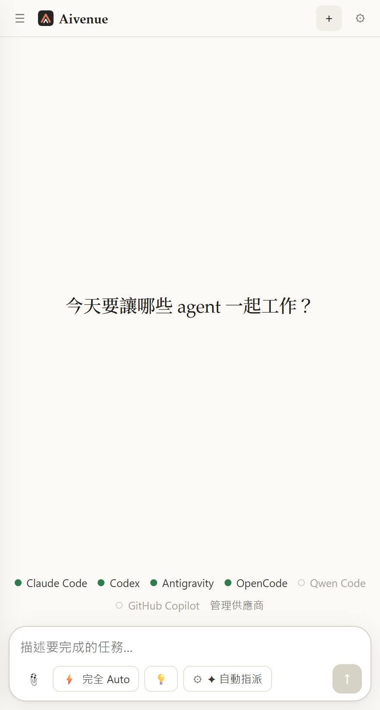</td>
<td>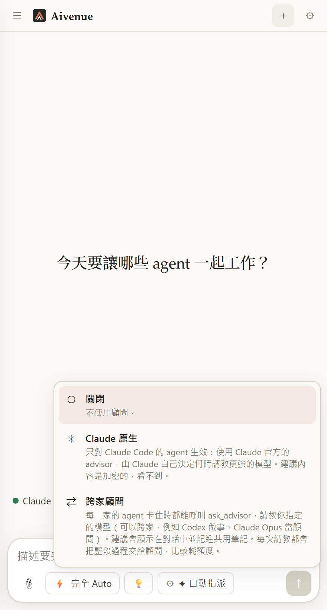</td>
</tr><tr>
<td align="center">VS Code 右側面板：📎、權限、💡 顧問、⚙ 角色</td>
<td align="center">窄面板中直接切換顧問模式</td>
</tr></table>

插件的詳細說明見 [packages/vscode/README.md](packages/vscode/README.md)。

## 快速開始

1. **開啟 Aivenue**：桌面版直接開啟 App；VS Code 版點狀態列的「Aivenue」，或命令面板（Ctrl+Shift+P）執行「Aivenue: 開啟 Aivenue」。
2. **登入工具**：右上角 ⚙ →「供應商與帳號」。每家都有「安裝」「登入」按鈕；登入會開一個終端機執行該工具自己的登入指令，在瀏覽器完成即可。也可以切換成「API」並填金鑰。
3. **選角色**：輸入框的「⚙ 角色」→「自動指派」（Aivenue 依能力與額度幫你分配）或「自訂指派」（自己選每個角色由誰做、用什麼模型）。
4. **選權限**：輸入框的權限按鈕（例如「⚡ 完全 Auto」）→ 決定 agent 可以自己動手到什麼程度，需要時勾選「隔離模式」。
5. **選工作資料夾**，輸入任務並送出（Enter 送出、Shift+Enter 換行）。VS Code 版預設是目前開啟的專案。
6. 看著進度清單（撰寫計畫 → 審查計畫 → 實作 → 審查程式碼）一路走完；審查通過後，最終結果與「這次產生或修改的檔案」會顯示在對話最下方。對話結束後可以在同一個對話繼續下指令。

## 實際範例：一個任務從頭到尾

以下是在空資料夾裡實際跑的一次（沒有任何人工介入），任務是：

> 建立一個 Node.js 命令列記帳工具 expense：add 新增支出、list 列出、summary 依分類加總並顯示百分比，資料存在 expenses.json，用 node:test 寫測試。請派 sub agent 平行分工：OpenCode 寫測試、Antigravity 寫 README，你負責主程式並整合。

角色：計畫與實作由 **Claude Code（Opus）** 負責，計畫與程式碼都由 **Codex** 審查。總共約 7 分鐘。

**① Claude 寫計畫，Codex 審查通過。** 計畫先訂出介面契約（函式名稱、資料格式、輸出格式、錯誤訊息），讓平行工作的 sub agent 照同一份規格做。

<p align="center">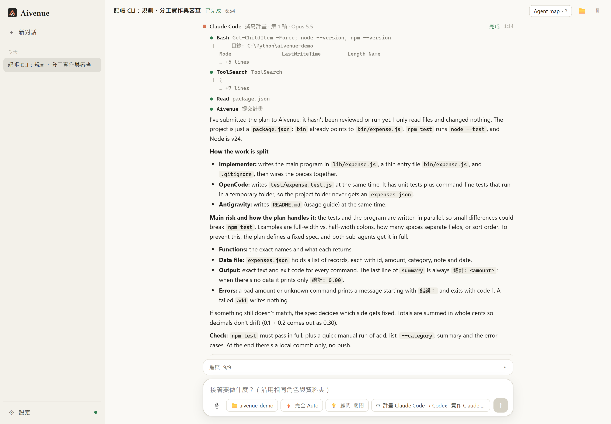</p>

**② 實作時派出兩個 sub agent 平行分工。** 點標題列的「Agent map」可以看到整個分工：Claude 實作時派出 OpenCode（DeepSeek）寫測試、Antigravity 寫 README，每個 agent 的模型、耗時、token 都一目了然。

<p align="center">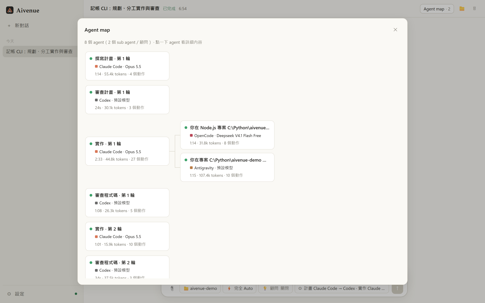</p>

點任何一個 agent，可以看到它的任務、由誰派出、token 明細、結果與完整處理過程：

<p align="center">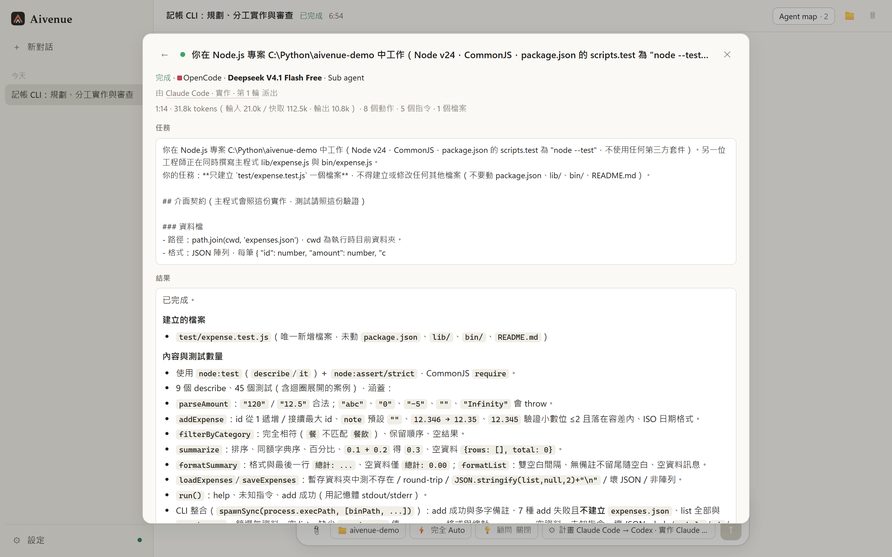</p>

**③ Codex 審查程式碼，抓到兩個問題退回。** 45 個測試雖然全部通過，Codex 另外實測發現 `1.005` 會被四捨五入成 `1.00`、極大金額會以 `null` 寫進檔案，要求修正並補測試。

<p align="center">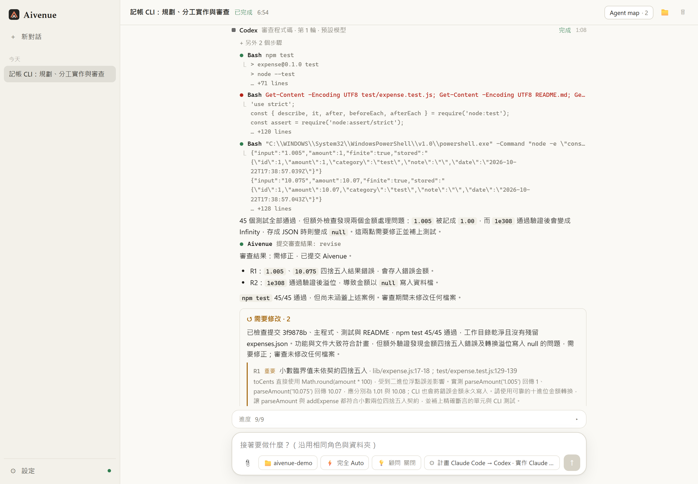</p>

**④ Claude 修正後第二輪審查通過。** 最終結果、這次新增的檔案（可預覽、開啟）與進度清單都整理在對話最下方。

<p align="center">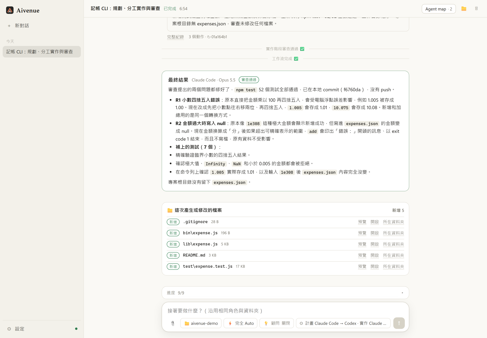</p>

## 範例任務

可以直接複製到輸入框試試看（工作資料夾選你的專案）：

| 想做的事 | 範例任務 | 建議設定 |
|---|---|---|
| 修 bug | `npm test 有 3 個測試失敗，找出原因並修好，不要改測試` | 關掉「計畫」，直接實作 → 審查 |
| 新功能 | `在設定頁加上深色模式切換，記住使用者的選擇，並補上測試` | 預設（計畫 ⇄ 審查 → 實作 ⇄ 審查） |
| 平行分工 | `把 src/api 底下的 5 個模組都補上單元測試，每個模組派一個 sub agent` | 開啟 Sub agents，允許 2～3 家 |
| 只要計畫 | `評估把資料庫從 SQLite 換成 PostgreSQL 要改哪些地方，列出步驟與風險` | 關掉「實作」，權限選「Plan 唯讀」 |
| 看畫面 | `把首頁改成響應式排版，做完拍 390 寬與 1280 寬的截圖給我看` | 審查者也會看截圖驗收 |
| 讀其他專案 | `參考額外資料夾裡的 api-docs，幫這個專案寫一個對應的 client` | 「工作流設定 → 額外資料夾」加入文件資料夾 |
| 發布到 GitHub | `整理 README 與 CHANGELOG，commit 後推送並開一個 Pull Request` | 先在「能力 → GitHub」登入；推送與開 PR 會先問你 |
| 卡住時請教 | `這個記憶體洩漏查了很久，找出原因並修好` | 開「💡 顧問 → 跨家顧問」，讓做事的 agent 卡住時請教更強的模型 |

## 主要功能

### 撰寫 ↔ 審查的工作流與角色指派

- **自動指派**：依各家能力分數、你的偏好（品質優先／平衡／省額度）、登入與額度狀態，決定誰寫計畫、誰審查、誰實作、誰驗收；審查者預設和撰寫者不同家，某家失敗或額度用完時自動換下一家。
- **自訂指派**：每個角色自己選供應商，並可覆寫模型與推理強度。對話中隨時可以在自動與自訂之間切換。
- **撰寫 ↔ 審查迴圈**：計畫與實作各自來回修改直到審查通過。審查結果會列出每個問題（嚴重／重要／次要），作者的回應（已修正或反駁）也會顯示。
- **每個階段都能開關**：計畫、計畫審查、實作、程式碼審查可分別關閉，例如簡單任務直接實作、或只要一份計畫。
- 達到回合上限或卡住時會暫停，讓你決定再給幾輪、直接接受或停止；勾「審查通過後先問我」則每個階段結束都會先問你。
- **模型與推理強度**：每家可設定預設模型與推理強度（模型清單直接從 CLI 讀取）。
- **常駐 CLI**：Claude Code 與 Antigravity 在同一段對話中沿用執行中的 CLI，閒置 5 分鐘才關閉；其他工具每輪用同一個 session 接續。

<p align="center">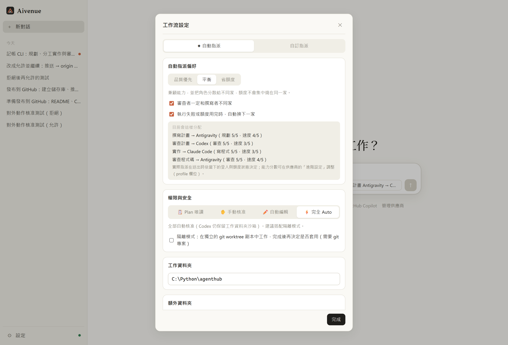</p>

### 權限與安全

| 等級 | 行為 |
|---|---|
| 📋 Plan 唯讀 | 只能讀檔與規劃，不改檔、不執行有副作用的指令 |
| ✋ 手動核准 | 每次改檔或執行指令都會在對話中跳出核准卡片（允許／這次對話都允許／拒絕） |
| ✏️ 自動編輯 | 工作資料夾內的編輯自動允許；執行指令依各家沙箱限制或被擋下 |
| ⚡ 完全 Auto | 全部自動核准。Codex 只能寫入工作資料夾；其他 CLI 的工具與指令仍可能改到資料夾外的檔案，建議搭配隔離模式 |
| 🛑 完整電腦存取 | AI 可以讀寫整台電腦的檔案、執行任何指令（Codex 改用 `danger-full-access`、OpenCode 允許外部資料夾、Qwen Code 的檔案工具加入使用者資料夾） |

- **完整電腦存取**：預設關閉；開啟前要勾選「我了解風險」，而且只對那段對話有效，新對話會回到完全 Auto。開著時權限按鈕與對話頂端會顯示紅色提示。規劃者、審查者、顧問仍維持唯讀，對外動作仍要你核准；寫入的 agent 會被要求不碰登入憑證與系統設定、外部的刪除或覆蓋要列在回報中（這些是規則，不是技術上的鎖）。結果下方會列出「工作資料夾外的改動」（由 agent 的寫檔工具記錄，用 shell 指令改的檔案不一定列得出來）。

- **對外動作要核准**：不論權限等級，agent 在做任何會改變這台電腦以外東西的動作前（git push、建立／合併／關閉 Pull Request、在 issue 留言或開關 issue、發布 release、觸發部署或 workflow 等），都必須先呼叫 `confirm_external_action`，在對話中跳出核准卡片，說明要做什麼、對象是哪裡；你允許才會執行，拒絕則 agent 不會做、並在報告中說明。讀取（git fetch/pull、看 PR、issue、CI）與本機 commit 不需要核准。被拒絕的動作會列在結果卡片下方；之後改變主意，按「改成允許並繼續」就會開一段接續的對話，完成這個動作（不會再問一次）以及因此略過的步驟。
<p align="center">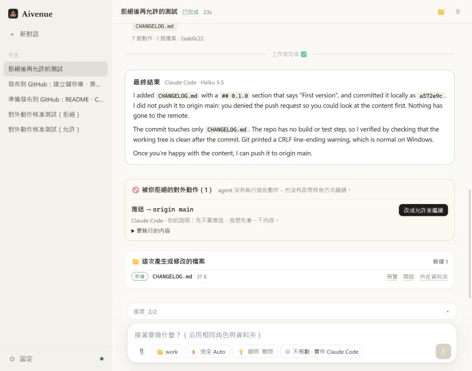</p>

- 目前只有 Claude Code 能在 headless 模式逐項詢問；其他工具選「手動核准」時會改用各自最接近的安全設定，設定視窗中會明確提示。
- **隔離模式**：agent 在獨立的 git worktree 副本中工作，完成後你再決定「套用到我的專案」「保留為 git 分支」或「捨棄」。
- **sub agent 不會比上層權限大**：唯讀的 agent 只能派出唯讀的 sub agent；「手動核准」時，派出 sub agent 也要先經你核准。
- **「這次對話都允許」的範圍**：指令類工具只涵蓋同一個程式（允許 `npm test` 不代表允許 `curl`），串接的指令只涵蓋完全相同的那一行。
- **登入與金鑰**：Aivenue 不經手帳密；API 金鑰只在執行時以環境變數交給該 CLI。桌面版用作業系統加密保存（Windows DPAPI），VS Code 版存在 VS Code SecretStorage。
- Aivenue 自己執行 git 時會關閉 hooks、fsmonitor 與外部 diff。

### Sub agent 與 Agent map

- 在「工作流設定 → Sub agents」打開並勾選允許被調用的供應商；任何角色在工作中都能透過 `spawn_subagent` 把子任務派給其他家，子任務的進度顯示在呼叫者卡片下方。
- 可指定每家當 sub agent 時用的模型與推理強度，並設定最多巢狀層數與同時執行上限。
- **Agent map**：標題列的「Agent map」按鈕會開啟所有 agent 的樹狀圖：誰派出誰、哪一家哪個模型、花了多久、用了多少 token、現在正在做什麼。點任何一個 agent 可看任務、token 明細（輸入／快取／輸出）、結果全文、改動的檔案與完整處理過程。

### 顧問模式

| 模式 | 說明 |
|---|---|
| 關閉 | 預設，不使用顧問 |
| Claude 原生 | 只對 Claude Code 的 agent 生效，使用 Claude 官方的 `--advisor`，由 Claude 自己決定何時請教。顧問模型可選別名（Opus／Fable／Sonnet，跟著 Claude Code 更新）、固定版本（例如 `claude-opus-5-5`）或自行輸入 |
| 跨家顧問 | 每一家的 agent **真的卡住時**才呼叫 `ask_advisor`，請教你指定的供應商與模型（可以跨家）。顧問唯讀、只負責判斷；建議會顯示在對話中並記進共用筆記。可限制每次對話最多請教幾次（預設 5 次） |

- **跨家顧問只負責判斷，查資料交給 sub agent**：顧問是最貴的模型，所以它不自己讀檔，只看發問者寫的情況說明（`context`）與最近一段紀錄。缺資料時，它會派唯讀的 sub agent 去查，逐份檢查回報，不夠或不對就帶著更精確的任務再派一次。「查證輪數」可設為預設 3 輪、自訂輪數或無限：連續這麼多輪都查不到需要的資訊，才允許顧問自己看那幾個檔案（無限＝永遠不自己讀）。做事的 agent 也會先自己或派 sub agent 查，真的解決不了才問顧問。
- **Claude 原生顧問的配對規則**：Claude Code 要求顧問至少和主模型一樣強（依官方配對表）。選到較弱的顧問時，設定會提醒；執行時那些 agent 改為不帶 `--advisor`，並在對話中說明，不會被默默忽略或讓 Claude Code 無法啟動。Claude Code 沒有提供顧問專用的推理強度。

在輸入框的「💡 顧問」按鈕直接切換（VS Code 版只顯示 💡 圖示），也可以在「工作流設定 → 顧問模式」設定。

<p align="center">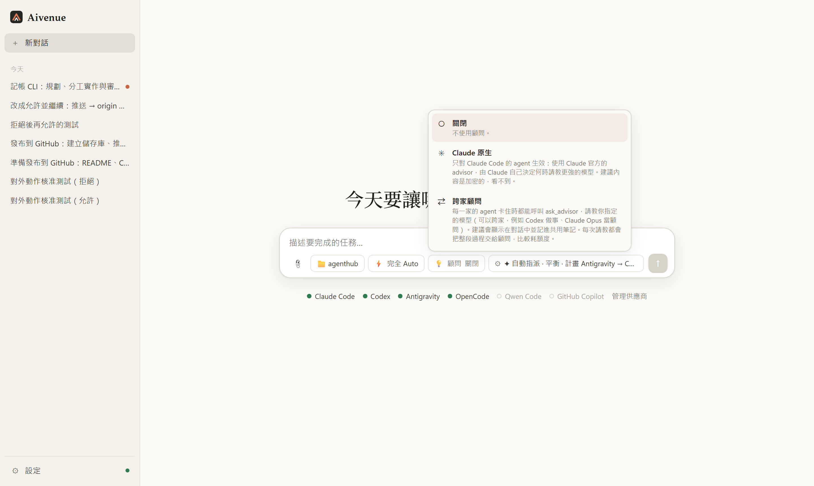</p>

### 共用上下文

agent 之間預設會交接計畫、審查意見與摘要，並看得到其他 agent 做了什麼與共用筆記（📌）。需要細節時，任何 agent 都能用 `read_context` 讀其他 agent 的完整紀錄（回覆、指令與輸出），用 `post_note` 留筆記給後面的人。「工作流設定 → 上下文分享」可改成「只交摘要」或「完整紀錄」（把上一棒的完整紀錄直接交給下一棒，最多 100 萬字）。

**容量、圓餅圖與壓縮**

- **圓餅圖**：輸入框旁的圓餅圖顯示 Aivenue 共用上下文用了幾 %（超過 70% 變黃、90% 變紅）。滑鼠移上去或點一下，會看到已用多少、再多少會自動壓縮、上次壓縮的結果、「現在壓縮」按鈕，以及每個 agent 自己的對話用量（例如「實作 · Claude Code 5%（52K / 1M）」），每一列都能單獨壓縮。
- **容量**：「工作流設定 → 共用上下文的容量與壓縮」可選 256K（預設）、512K、1M、2M 或自訂；這是 Aivenue 共用上下文的上限，不是模型的上限。送給每個 agent 的內容會依它的模型自動截取（最多約它上限的 20%），其餘用 `read_context` 讀，所以設大也不會讓 agent 讀不下。
- **只送新內容**：接續的對話只會收到上次之後的新筆記、新結果與新的共用記憶，不再每一輪重送全部。
- **自動與手動壓縮**：用到門檻（預設 80%，可選 70%／90%）時，下一個 agent 開始前會先壓縮；也能隨時按「現在壓縮」。壓縮者可選「自動」（已登入中的中價位模型，例如 Claude Haiku）或指定任何一家與模型。壓縮者不掛任何工具，只讀要壓縮的內容。
- **不怕弱模型漏掉重點**：目標、計畫、未解決的審查問題與你的指示一律逐字保留、不交給模型摘要；壓縮後會檢查原本提到的檔案路徑與問題編號是否都還在，漏了就重做一次，仍漏掉的逐字補回。被壓縮的原文不刪除，agent 可用 `read_context {agent_id: "notes"}` 讀回全部筆記。壓縮後沒有變小就保留原內容。
- **agent 對話快滿時詢問**：某個 agent 自己的對話用到 80%（可選 70%／90% 或不詢問）時，會跳出視窗問要不要壓縮，可選「現在壓縮」「稍後（90% 再問）」或「這個 agent 不再詢問」；工作中的 agent 會等這一輪結束再壓縮。壓縮方式依各家 CLI 而定：

| CLI | 壓縮方式 | 對話用量 |
|---|---|---|
| Claude Code | 在它的對話送 `/compact` | 有（含模型上限） |
| Codex | Codex app-server 的壓縮功能 | 有（含模型上限） |
| Antigravity | 在它的對話送 `/compact`（效果無法驗證） | 無法取得 |
| OpenCode 與其他 | 由壓縮者整理交接摘要，下一輪開新對話並附上摘要 | OpenCode 有（上限取自模型目錄） |

<p align="center">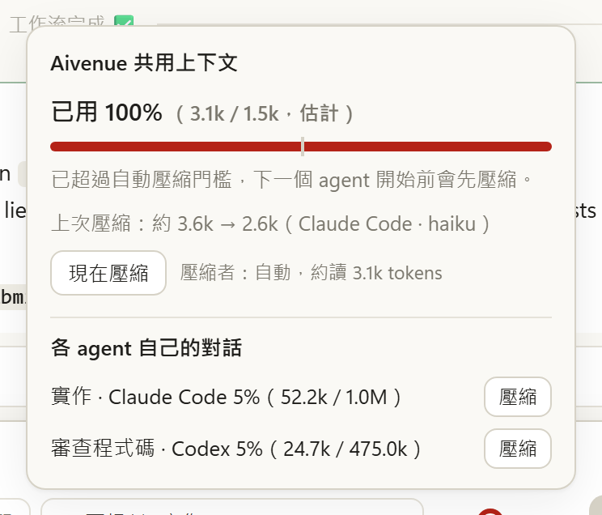</p>

### 額外資料夾

除了工作資料夾，可在「工作流設定 → 額外資料夾」加入最多 20 個資料夾（函式庫原始碼、文件、其他專案），所有 agent（包括 sub agent 與顧問）都能自己讀取與探索，類似 Claude Code 的 `--add-dir`。對話中也能增減，從下一個開始的 agent 起生效；agent 會把它們當參考資料，除非你要求，不會修改。

### 截圖與瀏覽器工具

- **截圖**：任何 agent 都能呼叫內建的 `capture_screenshot`，把網頁、本機 HTML 檔或開發伺服器（例如 `http://localhost:5173`）拍成截圖，直接顯示在對話中；可指定寬高（例如 390 寬模擬手機）與等待時間。實作者做完畫面會自己拍照確認，審查者也能看截圖驗收。使用本機的 Edge 或 Chrome 無頭模式與全新的臨時設定檔；找不到瀏覽器時可用環境變數 `AIVENUE_BROWSER` 指定路徑。截圖存在工作資料夾的 `.aivenue/screenshots/`（自動加入 `.gitignore`）。
- **瀏覽器工具**：「設定 → 能力 → 共用 MCP 伺服器」可一鍵啟用 **Playwright**（開網址、點擊、輸入、填表單）與 **Chrome DevTools**（console 錯誤、網路請求、效能分析）。兩者都用獨立、用完即丟的瀏覽器設定檔；預設不開啟，因為每個工具都會讓 agent 多讀一批工具說明。第一次使用時會自動下載工具（需要 Node.js）。

### GitHub 整合

在「設定 → 能力」的 GitHub 卡片，三步完成：

1. **一鍵安裝 Git 與 GitHub CLI**：Windows 用 winget、macOS 用 Homebrew、Linux 依系統套件管理員（apt／dnf／pacman／zypper）安裝，會開一個終端機顯示過程。
2. **登入 GitHub**：執行 `gh auth login --web`，在 GitHub 官方頁面輸入一次性代碼即可，並自動設定 `gh auth setup-git`，讓 git 推送使用同一個帳號；Aivenue 不經手你的密碼。
3. **GitHub MCP（選用）**：一鍵加入 GitHub 官方的 MCP 伺服器，所有供應商的 agent 都能直接查 issue、PR、程式碼和 CI。沿用上面的登入，不用另外申請 token；預設唯讀，也可勾選允許透過工具修改 GitHub。

<p align="center">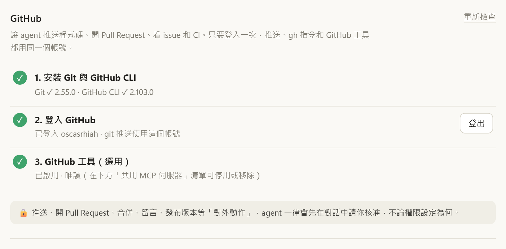</p>

登入後，agent 會被告知可以用 `gh` 處理 PR、issue、審查與 CI；推送、開 PR、留言等對外動作一律要先經你核准。

### 同一工具多帳號

例如有兩個 Claude 訂閱，可以兩個都登入並同時使用：「設定 → 供應商與帳號」展開該工具 →「其他帳號」→ 輸入名稱並「新增帳號」，再按「登入」。

- 每個帳號有獨立的設定資料夾與登入資料，會變成一個獨立的供應商，可同時指派到不同角色或當 sub agent。
- 自動指派會把同一個工具的不同帳號視為「同一家」（審查者仍會換成別家）；某個帳號額度用完時自動換到另一個帳號。
- 支援 Claude Code、Codex、GitHub Copilot CLI；OpenCode 的 API／訂閱方案可重複加入。Antigravity 的登入存在作業系統鑰匙圈，只能用一個帳號。

### 暫停／繼續與編輯已送出的訊息

| 動作 | 怎麼做 | 效果 |
|---|---|---|
| 暫停 | agent 工作中按 **❚❚** | 正在工作的 agent 立刻停下，還沒開始的 agent 也會等待；已完成的工作都會保留 |
| 繼續 | 暫停後按 **▶** | 從原本的進度接著做；暫停時在輸入框打的文字會一起交給 agent，可用來補充或修正方向 |
| 停止 | 標題列的「停止」 | 結束整個工作流 |
| 編輯已送出的訊息 | 在自己的訊息上按「編輯」 | 如果工作流還在跑，會先立即中斷，再用修改後的內容以相同設定重跑；舊的對話留在紀錄中 |
| 調整設定 | 工作中也能按 ⚙ 角色／權限 | 角色、模型、階段開關、sub agent、權限、上下文分享與壓縮、顧問等設定套用到接下來開始的 agent |

### 其他

- **附件**：拖曳、貼上（Ctrl+V 截圖）或 📎 選擇檔案。程式碼與文字檔所有 agent 都能讀；圖片交給能看圖的 agent；PDF、Word、Excel、PowerPoint、OpenDocument、Jupyter 由 Aivenue 轉成文字；ZIP 自動解壓（有數量與大小上限）。讀不到的檔案會明確告知 agent，送出前輸入框也會提醒。
- **能力（設定 → 能力）**：共用 MCP 伺服器（秘密值加密保存）、共用 Skills（Agent Skills 格式）、各角色的自訂指示。
- **用量**：設定 → 用量可看每家的使用紀錄與官方剩餘額度（和官方 App 一樣顯示「剩餘 %」）：Claude Code、Codex 的 5 小時與每週上限直接沿用 CLI 的登入；GitHub Copilot 的每月進階請求沿用已登入的 GitHub 帳號；Antigravity 連接一次 Google 帳號後顯示 Claude／GPT-OSS、Gemini Pro、Gemini Flash 各組額度。

## 從原始碼建置

需要 Node.js（CI 使用 Node 24）與 npm。

```bash
npm install
npm run build             # 建置 UI + MCP 橋接程式 + 桌面版 + VS Code 插件
npm run desktop           # 建置並啟動桌面版（Electron）
npm run package:desktop   # 產生 Windows 安裝版（NSIS）與免安裝版（portable）到 packages/desktop/release/
npm run package:linux     # 產生 release/Aivenue-<版本>-linux-x64.tar.gz
npm run package:vscode    # 產生 release/aivenue-vscode.vsix
```

其他指令：

```bash
npm run dev:hub           # 不開 Electron，只啟動引擎；用瀏覽器開啟印出的網址
npm run typecheck         # 所有套件的 TypeScript 型別檢查
```

推送 `v*` 標籤時，[.github/workflows/release.yml](.github/workflows/release.yml) 會自動打包上述檔案並建立 GitHub Release。

## 專案架構

```
packages/
  core/     引擎：供應商 adapter、事件解析、撰寫↔審查迴圈、sub agent、用量統計、GitHub 整合、
            Hub（HTTP + WebSocket，只在 127.0.0.1）
  bridge/   MCP 橋接程式（stdio）：每個 agent CLI 啟動時都會掛上，提供 submit_plan / submit_review /
            submit_work / report_progress / spawn_subagent / wait_subagent / list_providers /
            capture_screenshot / read_context / post_note / ask_advisor / confirm_external_action
  ui/       React 介面（聊天式對話、角色設定、設定頁），Vite 建置
  desktop/  Electron 外殼（Windows 與 Linux），linux/ 內有 install.sh / uninstall.sh
  vscode/   VS Code 插件外殼（Webview），自帶完整引擎
scripts/
  build.mjs          建置所有套件（esbuild + Vite）
  package-linux.mjs  把 linux-unpacked 打包成帶有 Unix 權限的 tar.gz
```

- **供應商設定**是純資料（參數群組 + 變數），內建的幾家只是預設值，可在介面中修改或新增。
- **進度**：解析各家 CLI 的串流事件（Claude／Qwen stream-json、Codex JSONL、Antigravity stream-json、OpenCode JSON、Copilot JSONL），統一成相同格式即時顯示。
- 為了讓 agent 回報結果，Aivenue 會在部分工具的設定中加入自己的 MCP 項目（例如 Antigravity 的 `~/.gemini/config/mcp_config.json`），不會改動其他設定。

## 常見問題

**Windows 擋下安裝檔，顯示「智慧型應用程式控制已封鎖」或 SmartScreen 警告？**
目前的安裝檔沒有程式碼簽章。SmartScreen 警告可以按「其他資訊 → 仍要執行」；但如果 Windows 11 的「智慧型應用程式控制」（Smart App Control）是開啟的，未簽章的程式可能會被直接擋下，沒有略過的選項。這時可以改用 [VS Code 插件](#vs-code-插件)，或[從原始碼建置](#從原始碼建置)後以 `npm run desktop` 執行。「智慧型應用程式控制」的開關在「Windows 安全性 → 應用程式與瀏覽器控制」；在部分 Windows 版本中關閉後無法直接再開啟，請自行評估是否要關閉。

**有 macOS 版嗎？**
目前沒有提供 macOS 安裝檔。在 macOS 上可以使用 VS Code 插件（引擎是跨平台的），或從原始碼以 `npm run dev:hub` 啟動後用瀏覽器開啟。

**一定要安裝桌面 App 嗎？**
不用。VS Code 插件可以單獨使用，只要這台電腦有安裝並登入你要用的 AI 工具即可。

**額度怎麼算？**
每家工具都用你自己的帳號或金鑰，額度照各家規則計算。設定 → 用量可以看每家的使用紀錄，以及 Claude Code、Codex、GitHub Copilot、Antigravity 的官方剩餘額度與重置時間。

**為什麼選了「手動核准」，某家還是自己做了？**
除了 Claude Code，各家的 headless 模式無法逐項詢問，Aivenue 會改用最接近的安全設定（例如只允許編輯、禁止執行指令），設定視窗會標示。需要完全掌控時，請搭配隔離模式。

**Linux 上用 npm 安裝工具失敗（EACCES）？**
如果 Node.js 是用系統套件管理員裝的（例如 `apt install nodejs`），npm 的全域資料夾需要 sudo；Aivenue 安裝前會先檢查並告訴你怎麼處理（建議改用 nvm，或把 npm 全域資料夾改到家目錄）。Aivenue 會讀取登入 shell 的 PATH，所以用 nvm、fnm 或 `~/.local/bin` 安裝的工具也找得到。

**資料存在哪裡？**
設定、對話紀錄、用量統計都在 `~/.aivenue/`（可用 `AIVENUE_HOME` 改位置）。截圖在工作資料夾的 `.aivenue/screenshots/`。

## 授權

[MIT](LICENSE)
