# Aivenue

<p align="center">
  <a href="https://github.com/oscasrhiah/aivenue/releases/latest"></a>
  <a href="https://github.com/oscasrhiah/aivenue/releases"></a>
</p>

> **English summary** — Aivenue lets the subscription-based AI coding CLIs you already have (Claude Code, Codex, Antigravity, GitHub Copilot CLI, OpenCode, Qwen Code) work together in one workflow: one writes the plan and another reviews it, one implements and another verifies the code, looping until the reviewer approves. Any agent can hand sub-tasks to another vendor's CLI as a sub-agent. It runs locally as a desktop app (Windows, Linux x64) or a VS Code extension, uses your own accounts or API keys, and never handles your passwords. Licensed under MIT. **Warning:** Google's Antigravity terms prohibit access through third-party tools; using Antigravity through Aivenue may get your Google account suspended or blocked.

讓多家訂閱制 AI coding CLI 在同一個工作流裡分工合作：一家寫計畫、另一家審查，來回修改直到通過；接著實作，再由審查者驗收程式碼，直到通過為止。任何 agent 在工作中都能透過 Aivenue 把子任務派給其他家的 agent 當子 agent。全程即時顯示每個 agent 讀了什麼、改了什麼、跑了什麼指令。

<p align="center">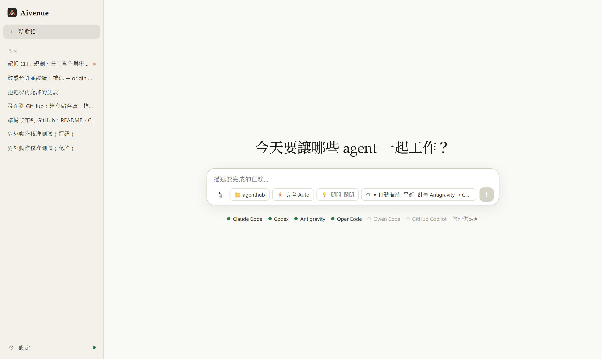</p>

### 示範影片

https://github.com/user-attachments/assets/52121552-f158-4b92-a55a-004743efcdad

<p align="center"><sub>影片約 1 分鐘，畫面加速播放：輸入任務 → Antigravity 額度用完、自動改由 Claude 寫計畫 → Codex 審查退回 2 個問題 → 第二輪通過 → Claude 實作並平行派出 OpenCode、Antigravity 兩個子 agent → 審查者失敗時自動換 Codex 驗收 → 完成。</sub></p>

---

> ⚠️ 使用 Antigravity（`agy`）前請先看[這段風險說明](#支援的-ai-工具)：Google 的服務條款禁止透過第三方工具存取，可能導致帳號被停用或封鎖。

## 目錄

- [Aivenue 是什麼](#aivenue-是什麼)
- [支援的 AI 工具](#支援的-ai-工具)
- [下載與安裝](#下載與安裝)
- [快速開始](#快速開始)
- [看懂一個工作流：時間線、活動紀錄與驗證](#看懂一個工作流時間線活動紀錄與驗證)
- [實際範例：一個任務從頭到尾](#實際範例一個任務從頭到尾)
- [範例任務](#範例任務)
- [主要功能](#主要功能)
- [從原始碼建置](#從原始碼建置)
- [專案架構](#專案架構)
- [常見問題](#常見問題)
- [授權](#授權)

## Aivenue 是什麼

很多人同時訂閱了好幾家 AI coding 工具，但每一家都只能各做各的：要讓 Claude 寫、Codex 審，就得自己在兩個終端機之間複製貼上計畫和審查意見；單一模型自己寫自己審，也容易漏掉同樣的盲點。

Aivenue 把這些 CLI 串成一個工作流：

```
撰寫計畫 ⇄ 審查計畫（來回修改直到通過）→ 實作 ⇄ 審查程式碼（來回修正直到通過）
```

- **用你已經有的帳號**：各家 CLI 用自己官方的瀏覽器流程登入，Aivenue 不經手帳號密碼；也可以改用 API 金鑰。
- **不同家互相審查**：審查者預設一定和作者不同家，降低同一個模型的盲點。
- **完全在本機執行**：Aivenue 只在 127.0.0.1 開服務（以隨機權杖保護），設定、對話紀錄與用量統計存在 `~/.aivenue/`（可用環境變數 `AIVENUE_HOME` 改位置）。
- **兩種外殼、同一套引擎**：桌面 App（Windows、Linux x64）與 VS Code 擴充功能共用相同的引擎與介面。
- **看得到證據，不只看 agent 怎麼說**：每個結果旁邊都分開列出 Aivenue 自己看到執行的檢查，以及還需要重驗的部分。

## 支援的 AI 工具

至少要在這台電腦上安裝並登入一家。Aivenue 的「設定 → 供應商與帳號」對每一家都有「安裝」「登入」按鈕，會自動使用該平台的安裝方式；也可以自己在終端機執行下表的指令。

| 工具 | 訂閱登入 | API 金鑰 | 安裝指令 |
|---|---|---|---|
| Claude Code | Claude Pro / Max | Anthropic API | `npm install -g @anthropic-ai/claude-code` |
| Codex | ChatGPT Plus / Pro | OpenAI API | `npm install -g @openai/codex` |
| Antigravity（`agy`） | Google AI Pro / Ultra | — | Windows：`winget install --id Google.AntigravityCLI -e`<br>macOS / Linux：`curl -fsSL https://antigravity.google/cli/install.sh \| bash` |
| GitHub Copilot CLI | Copilot Pro / Pro+ / Business | 自帶金鑰（BYOK） | Windows：`winget install --id GitHub.Copilot -e`<br>macOS / Linux：`npm install -g @github/copilot` |
| OpenCode | 內建免費模型，另可接上百家 API 與訂閱方案（Kimi、通義、GLM、MiniMax…） | ✓ | `npm install -g opencode-ai` |
| Qwen Code | QwenCloud Token Plan | 任何 OpenAI 相容 API | `npm install -g @qwen-code/qwen-code` |

> ⚠️ **Antigravity（`agy`）使用風險**：Google 的 Antigravity 服務條款明確禁止透過第三方軟體、工具或服務（包括代理伺服器）存取 Antigravity。在 Aivenue 中使用 Antigravity 屬於這種情況，**可能導致你的 Google 帳號被停用或封鎖**。Aivenue 保留這項功能，是否使用請自行評估風險。

- Antigravity 是 Google 的訂閱版本，取代已停止個人登入的 Gemini CLI。需要 Google AI Studio 金鑰的話，可在「新增 → 按量 API」加入 Google。
- 也可以在「設定 → 供應商與帳號 → 新增」從清單加入其他 API／訂閱方案，或自訂任何有命令列模式的 CLI（例如 Kimi、Grok 等）。
- 用 npm 安裝的工具需要 Node.js。
- 不用的工具可以在同一處按「解除安裝」：用當初安裝的 npm／winget／Homebrew 移除，登入資料與設定會保留。
- 想用免費模型：在「設定 → 能力 → 內建擴充」打開 **OmniRoute**，它會變成一家供應商，見[內建擴充](#內建擴充)。

## 下載與安裝

所有安裝檔都在本儲存庫的 **GitHub Releases** 頁面下載（`<版本>` 例如 `0.3.0`）：

<p align="center">
  <a href="https://github.com/oscasrhiah/aivenue/releases/latest"></a>
</p>

> 在下載頁面最下方的 **Assets** 區塊點選檔案即可下載。

| 平台 | 檔案 | 安裝方式 |
|---|---|---|
| Windows 安裝版 | [`Aivenue-Setup-<版本>.exe`](https://github.com/oscasrhiah/aivenue/releases/latest) | 執行安裝程式，可自選安裝資料夾 |
| Windows 免安裝版 | [`Aivenue-<版本>-portable.exe`](https://github.com/oscasrhiah/aivenue/releases/latest) | 直接執行，不需安裝 |
| VS Code 擴充功能 | [`aivenue-vscode-<版本>.vsix`](https://github.com/oscasrhiah/aivenue/releases/latest) | 在 VS Code 中「從 VSIX 安裝」 |
| Linux x64 | [`Aivenue-<版本>-linux-x64.tar.gz`](https://github.com/oscasrhiah/aivenue/releases/latest) | 見下方 [Linux](#linuxx64) |

> **0.3.0 的 Linux 版是事後補發**：0.3.0 先發布 Windows 版與 VS Code 擴充功能，`Aivenue-0.3.0-linux-x64.tar.gz` 在 Ubuntu 上驗收過之後，才加到同一個 Release。驗收範圍、SHA-256 與已知限制，見 [v0.3.0 Release](https://github.com/oscasrhiah/aivenue/releases/tag/v0.3.0) 說明的「Linux x64 補發」。Ubuntu 20.04 上桌面版與 VS Code 同時寫入記憶，是用本機重建的測試版 `.vsix` 驗證的。已發布的 `.vsix` 在 Linux 上，以及 WSL 與 Remote 的完整流程，都還沒有驗收。

### Windows

- **安裝版**：執行 `Aivenue-Setup-<版本>.exe`，依畫面完成安裝（可更改安裝位置）。
- **免安裝版**：下載 `Aivenue-<版本>-portable.exe` 後直接執行。
- 安裝檔目前沒有程式碼簽章，Windows 可能會出現 SmartScreen 警告或被「智慧型應用程式控制」擋下，見[常見問題](#常見問題)。

### Linux（x64）

下載 `Aivenue-<版本>-linux-x64.tar.gz` 後：

```bash
tar -xzf Aivenue-<版本>-linux-x64.tar.gz
cd Aivenue-<版本>-linux-x64
./install.sh
```

- 不需要 sudo，安裝到目前使用者：程式在 `~/.local/share/aivenue`（可用環境變數 `AIVENUE_INSTALL_DIR` 改位置），指令 `~/.local/bin/aivenue`，並加入應用程式選單。
- 安裝後從應用程式選單開啟，或在終端機執行 `aivenue`。
- 移除：執行安裝資料夾（或解壓資料夾）中的 `./uninstall.sh`。
- 0.3.0 Linux 套件的安裝與卸載：
  - 自訂位置的安裝不必再設定 `AIVENUE_INSTALL_DIR` 就能卸載：腳本會找它所在的安裝，或 `aivenue` 指令指向的那份。
  - 卸載會依安裝紀錄，移除能確認屬於 Aivenue 的檔案。安裝紀錄包括套件清單 `.aivenue-files`，以及安裝中斷時留下的安裝計畫。安裝資料夾裡的使用者檔案，以及對話與設定（`~/.aivenue`），都會保留。
  - `AIVENUE_INSTALL_DIR` 要指定一個專用的資料夾：不存在、空的，或之前的 Aivenue 安裝。非空又不是 Aivenue 安裝的資料夾，安裝時會拒絕。
- **自己打包的差別**：0.3.0 Linux 套件的安裝、卸載腳本與 `EPIPE` 修正，還沒有合併進這個分支。從這裡用 `npm run package:linux` 打包，得到的是舊的安裝與卸載腳本，也沒有那個修正。

### VS Code 擴充功能

1. VS Code → 擴充功能 → 右上角「⋯」→「從 VSIX 安裝…」，選擇 `aivenue-vscode-<版本>.vsix`
   （或在終端機執行 `code --install-extension aivenue-vscode-<版本>.vsix`）。
2. 安裝後狀態列左下會出現「Aivenue」，右側次要側邊欄會多一個 Aivenue 圖示。
3. 需要 VS Code 1.143 以上才會顯示在右側次要側邊欄；舊版可用「Aivenue: 在編輯器分頁中開啟 Aivenue」。
4. 擴充功能自帶完整引擎，**不需要**另外安裝桌面 App 或 Node.js；Remote / WSL / SSH 也能用（AI 工具要裝在遠端那台機器上）。Ubuntu 20.04 的並行寫入，是用本機重建的測試版 `.vsix` 驗證的；已發布的 `.vsix` 在 Linux 上，以及 WSL 與 Remote 的完整流程，都還沒有驗收。
5. 在同一台電腦上，桌面版與 VS Code 擴充功能可以同時開，共用 `~/.aivenue/` 裡的設定、對話紀錄與[專案記憶](#專案記憶)。

<table align="center"><tr>
<td>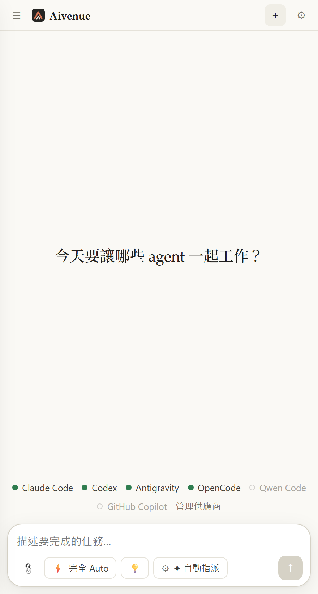</td>
<td>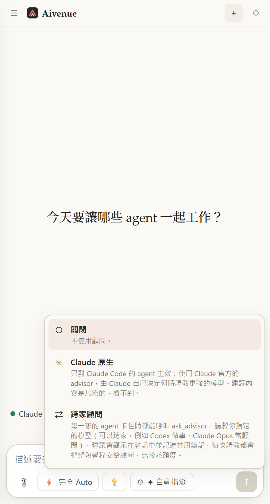</td>
</tr><tr>
<td align="center">VS Code 右側面板：📎、權限、💡 顧問、⚙ 角色</td>
<td align="center">窄面板中直接切換顧問模式</td>
</tr></table>

擴充功能的詳細說明見 [packages/vscode/README.md](packages/vscode/README.md)。

## 快速開始

1. **開啟 Aivenue**：桌面版直接開啟 App；VS Code 版點狀態列的「Aivenue」，或命令面板（Ctrl+Shift+P）執行「Aivenue: 開啟 Aivenue」。
2. **登入工具**：右上角 ⚙ →「供應商與帳號」。每家都有「安裝」「登入」按鈕；登入會開一個終端機執行該工具自己的登入指令，在瀏覽器完成即可。也可以切換成「API」並填金鑰。
3. **選角色**：輸入框的「⚙ 角色」→「自動指派」（Aivenue 依能力與額度幫你分配）或「自訂指派」（自己選每個角色由誰做、用什麼模型）。
   - 同一個視窗的「流程模式」：預設是「自訂」，新對話走完整流程（計畫 ⇄ 審查 → 實作 ⇄ 審查）；一般的小修改可以選「標準」，省掉計畫階段；只要審查別人的變更就選「獨立審查」，見[流程模式](#流程模式標準獨立審查與自訂)。
   - 「專案記憶」預設是「完整」：會帶入這個專案以前留下的記憶，見[專案記憶](#專案記憶)。
4. **選權限**：輸入框的權限按鈕（例如「⚡ 全自動」）→ 決定 agent 可以自己動手到什麼程度，需要時勾選「隔離模式」。
5. **選工作資料夾**，輸入任務並送出（Enter 送出、Shift+Enter 換行）。VS Code 版預設是目前開啟的專案。
6. **看它做**：每個 agent 一張卡片，正在跑的指令即時更新；需要你核准或決定時，按鈕就在那張卡片裡。怎麼讀這些卡片見[看懂一個工作流](#看懂一個工作流時間線活動紀錄與驗證)。
7. **看結果**：完成後，對話最下方是「最終結果」，附上交付物、驗證範圍與「這次產生或修改的檔案」。之後可以在同一個對話繼續下指令，agent 會帶著前面的脈絡接著做。

## 看懂一個工作流：時間線、活動紀錄與驗證

### 卡片怎麼看

- **一個回合就是一段文字**：每個 agent 回合沒有色條也沒有外框，角色寫在標頭（「OpenCode · 實作」）；計畫、審查結論、驗收結果和實作摘要直接寫在回合裡，子 agent 與顧問的回合標頭小一級。agent 的過程說明較小、較淡，太長會收合。
- **只有最終結果有外框**：工作流結束時，對話最下方的「最終結果」（獨立審查是「審查報告」）是唯一有外框的卡片。
- **執行中只看正在發生的事**：
  - 同一個指令在原位從「執行中」變成成功或失敗，旁邊是它自己的經過時間。
  - 依實際順序顯示讀檔、改檔、執行指令、失敗與重跑。連續的讀檔、搜尋、寫入、終端指令收成一行，例如「讀取 3 個檔案」「執行 2 個終端指令」，後面列出檔名或指令本身，點開看每一筆。失敗與執行中的呼叫一直留在畫面上。
  - 終端指令標成「終端」（紀錄看不出是哪個 shell）。失敗的指令先顯示錯誤訊息與 `actual`／`expected`，點開看完整的指令、輸出與堆疊。
  - 你點開的那一筆會保持展開、留在原位，新事件進來不會收起或擠掉它。
  - Aivenue 自己的呼叫（查紀錄、回報進度、交結果）不在預設畫面上，在活動紀錄裡。
  - 沒有可確認的動作時顯示「正在處理」；等你核准時顯示「等你核准 N 個動作」，核准按鈕就在這張卡片裡；暫停時顯示「已暫停」。
- **卡片標頭只寫誰、做什麼**，例如「OpenCode · 實作」；用的模型、實際回答的模型與推理強度在標頭的提示裡，也在活動紀錄最上面。
- **結束的卡片只留一行結果**，最多兩段，例如「實作完成 · 檢查通過 1 項、檢查失敗 1 項」。其餘的（例如「改了 1 個檔案」）在這一行的提示裡，沒顯示的檔案數也會寫在活動紀錄那一行。檔案數只算 agent 用編輯工具改的檔案，整輪新增與修改了哪些檔案看最終結果的「交付」。工作流進行中，檢查、審查問題、「待驗證」與「待你決定」的事仍留在卡片上；工作流結束後，結果集中在最終結果。
- **返工時寫出原因**：例如階段標題「第 2 輪　審查退回 1 個問題：R1」。
- **筆記一行**：共用筆記只顯示一行，點一下展開；只是重複結果的筆記會標明。
- **閱讀位置**：往上捲動看舊內容時，畫面不會被新事件拉走，並出現「↓ 回到最新」。

### 活動紀錄

每張卡片底部同一個位置都有「▸ 活動紀錄」，旁邊寫這個 agent 做了幾個動作、改了幾個檔案、留了幾則筆記。點開依序是：

1. 讀檔、改檔、執行的指令與輸出，依實際順序（勾「原始紀錄」看未整理的事件）。
2. 「紀錄與交接」：Aivenue 的紀錄、進度回報、筆記與交接收成一行，再點開才看。
3. 截圖。
4. 實作者：工作流結束後的實作摘要（agent 自己的說法），以及 Aivenue 看到的檢查。
5. 改過的檔案（只有失敗的編輯標「可能改動」；終端指令寫入的檔案不在這裡）與交接。
6. 原始提交資料：agent 交出的原樣內容，卡片上顯示的是整理後的版本。

### Aivenue 看到的檢查

Aivenue 會把它實際看到 agent 執行的檢查（測試、建置、型別檢查、lint）和 agent 自己寫的「實作摘要」分開記錄。這份紀錄是交結果當下的狀態：工作流進行中顯示在實作者的卡片上，結束後顯示在最終結果的「檢查」裡，也是卡片一行結果與「驗證範圍」的依據。

每項檢查一列，例如：

- `✓ 通過 node test/slug.test.js · 先前失敗，重跑通過`
- `✗ 失敗 node test/legacy.test.js`

點開一列，看每一次執行的時間、結果與輸出，以及這項檢查之後是否改過檔。每一列只寫實際的結果與重跑歷史；這項檢查是不是這次的範圍、要跑幾次，Aivenue 不會從你的文字推斷成標籤（日後可能改由你明確設定）。

| 標示 | 意思 |
|---|---|
| ✓ 通過 | 這項檢查單獨執行，而且成功 |
| ✗ 失敗 | 執行它的那一行失敗了（和其他步驟串在一起時，失敗的可能是別的步驟，要看輸出） |
| ⚠ 執行完成，但輸出回報失敗 | 結束碼正常，但輸出裡有失敗訊息 |
| ◦ 在較長的指令中執行 | 和其他步驟串在一起、整行成功；檢查本身的結果要看輸出 |
| ◦ 不確定是否執行 | 看不出這項檢查到底有沒有跑，見下方 |
| 需重驗（點開後） | 檢查之後檔案又改過了，要重跑才能確認現在的程式碼 |
| 檔案可能已變（點開後） | 檢查之後有失敗的編輯，請確認 |

- **沒有任何一項**時會寫「沒有看到任何檢查執行：摘要裡說的通過或完成，是 agent 自己的說法」。
- **什麼算檢查**：`npm test`、`pytest`、建置、型別檢查、lint 這類指令，以及 `node test.js`、`node tests/…`、`node *.test.js`。只是讀測試檔、`git diff`，或 `echo`、`printf` 引號裡寫到的指令都不算。
- **同一項檢查跑了好幾次**：只有同時符合三點，才合成一列（最後一次的結果，先前的放在點開後），否則兩筆都列出來，先前的失敗不會被蓋掉：
  1. 同一項檢查：指令與參數相同（引號內照原樣比對，大小寫不同算不同）。
  2. 同一個已知的工作目錄：前面的 `cd`、`Set-Location`、`pushd` 與 `--prefix`、`-C`、`--cwd` 都算進去，所以 `cd packages/api && npm test` 和 `cd packages/web && npm test` 是兩項。
  3. 後一次確實執行了：單獨執行，或前面只用 `;`、換行、`|` 串接，或整行成功的 `&&` 鏈。
- **「不確定是否執行」是什麼意思**：從指令看不出控制流程一定走到這項檢查。例如它在 `||` 之後、在不能確認成功的 `&&` 之後、前面有 `exit`、`return`、分支、迴圈或背景 `&`，或工作目錄無法確定（可能被跳過的 `cd`、輸出顯示 `cd` 失敗）。這時會註明整行是成功還是失敗；這筆不算通過也不算失敗，也不會取代先前的紀錄。要確定結果，請 agent 單獨再跑一次。

### 進度標頭與最終結果

- **進度標頭**一行寫兩件事：本輪狀態，再加上最要緊的一件（等你處理的事、工作流步驟、未回報完成的步驟或子 agent 批次），例如「本輪工作流已完成 · 子 agent 批次 29/30 完成、1 受阻」。其餘的（例如「背景程序 1 個仍在執行」）在這一行的提示裡，展開進度面板也會列出。「本輪完成」不代表每一批都成功，受阻的批次與還在跑的程序會寫出來。只是重複本輪狀態的「卡在」（例如「已暫停」）不另外畫一行。
- **工作流步驟**只在進度面板列一次；agent 沒有回報完成的步驟標成「未回報完成」，不會自動補成完成。工作流結束時，進度面板自動收成一行；有未回報完成的步驟時，這一行會寫出來，點開看是哪幾步。
- **最終結果**在對話最下方，是工作流結束後主要的閱讀入口：
  - 「交付」：照工作流的檔案清單列出「新增 NOTES.md」「修改 src/slug.js」。點開一個檔案，看它是哪個 agent 用編輯工具改的（比對工作資料夾下的完整路徑）；無法確認時只寫「由資料夾比對發現」，並列出提到這個檔名的指令原文（只是文字比對）。
  - 「檢查」：每項檢查一列，見上方。
  - 「驗證範圍」：只依 Aivenue 的紀錄寫出，每項檢查只算一次，例如「2 項檢查：1 通過、1 失敗」「1 項待驗證（審查未能確認）」「目標驗收 3/3」；沒看到任何檢查時會明說。
  - 最後是實作者的說明全文，標明是 agent 的自述。
  - 有目標驗收時可以展開「驗收證據」：量測時的版本（commit）、git tree、時間，以及每個指標的值與證據。卡片上只寫「版本 …」，commit 與 tree 在它的提示裡。驗收之後又改過檔時，寫「上次目標驗收 N/M，之後有改動，需重驗」。
- **工作資料夾外的改動**依資料夾收合，例如「…/outside/results/ · 51 個檔案」，點開才列出檔案；任務文字提到那個資料夾時會加標籤（只是文字比對）。

## 實際範例：一個任務從頭到尾

以下是在空資料夾裡實際跑的一次（沒有任何人工介入），任務是：

> 建立一個 Node.js 命令列記帳工具 expense：add 新增支出、list 列出、summary 依分類加總並顯示百分比，資料存在 expenses.json，用 node:test 寫測試。請派子 agent 平行分工：OpenCode 寫測試、Antigravity 寫 README，你負責主程式並整合。

角色：計畫與實作由 **Claude Code（Opus）** 負責，計畫與程式碼都由 **Codex** 審查。總共約 7 分鐘。

**① Claude 寫計畫，Codex 審查通過。** 計畫先訂出介面契約（函式名稱、資料格式、輸出格式、錯誤訊息），讓平行工作的子 agent 照同一份規格做。

<p align="center">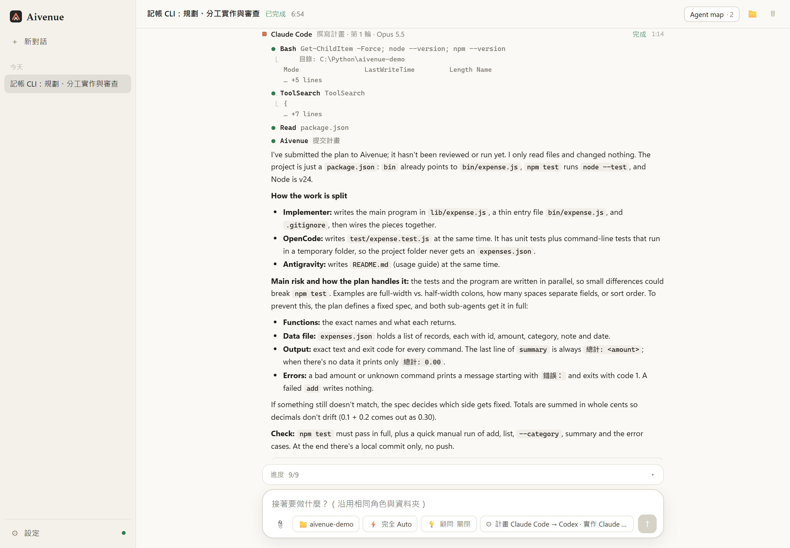</p>

**② 實作時派出兩個子 agent 平行分工。** 點標題列的「分工圖」可以看到整個分工：Claude 實作時派出 OpenCode（DeepSeek）寫測試、Antigravity 寫 README，每個 agent 的模型、耗時、token 都一目了然。

<p align="center">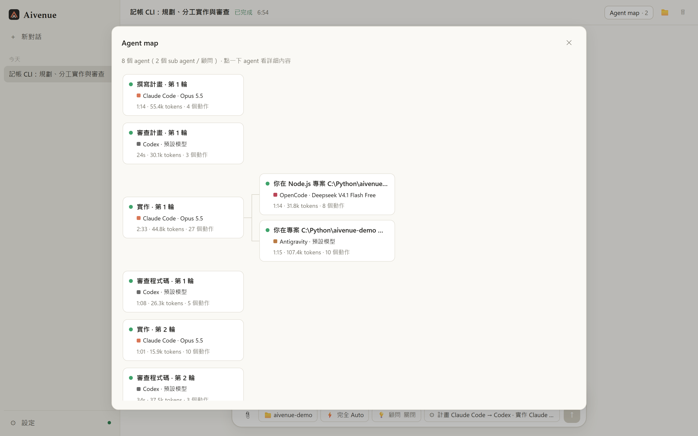</p>

點任何一個 agent，可以看到它的任務、由誰派出、token 明細、結果與完整處理過程：

<p align="center">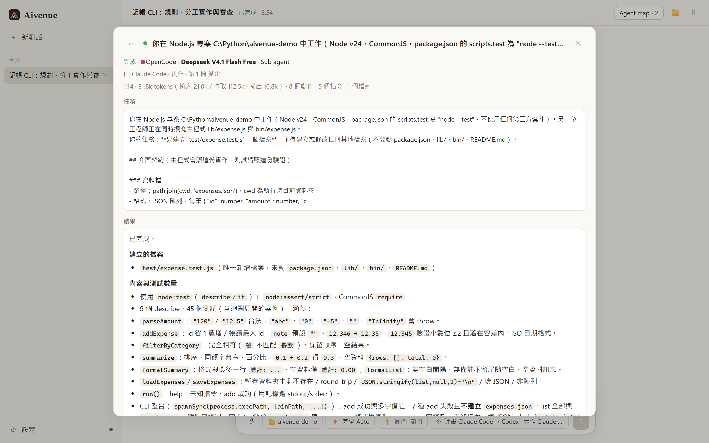</p>

**③ Codex 審查程式碼，抓到兩個問題退回。** 45 個測試雖然全部通過，Codex 另外實測發現 `1.005` 會被四捨五入成 `1.00`、極大金額會以 `null` 寫進檔案，要求修正並補測試。

<p align="center">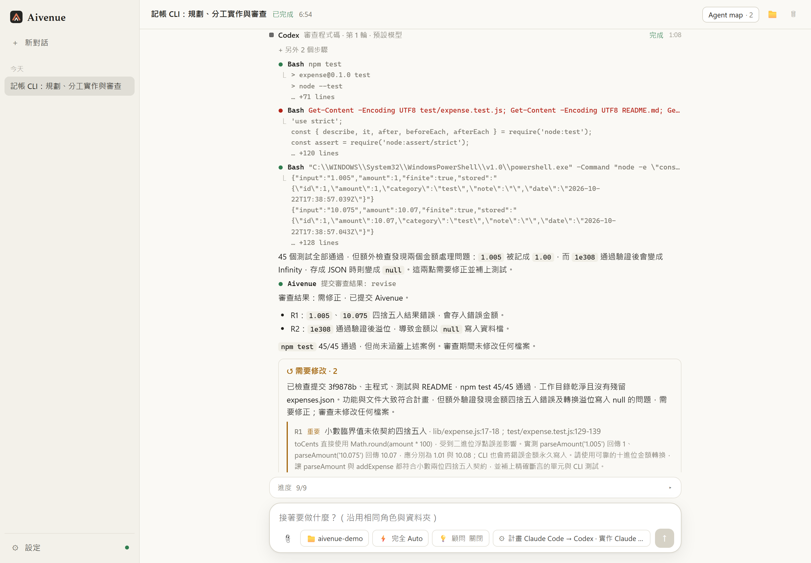</p>

**④ Claude 修正後第二輪審查通過。** 最終結果、這次新增的檔案（可預覽、開啟）與進度清單都整理在對話最下方。

<p align="center">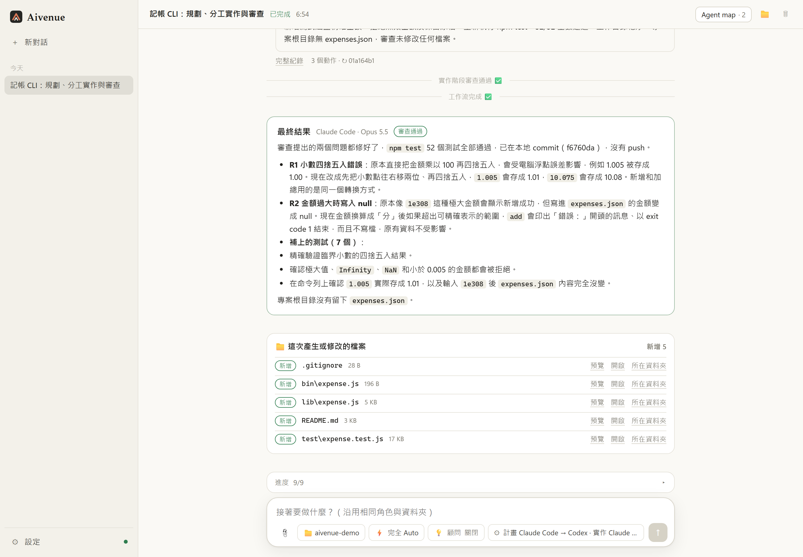</p>

## 範例任務

可以直接複製到輸入框試試看（工作資料夾選你的專案）：

| 想做的事 | 範例任務 | 建議設定 |
|---|---|---|
| 修 bug | `npm test 有 3 個測試失敗，找出原因並修好，不要改測試` | 關掉「計畫」，直接實作 → 審查 |
| 新功能 | `在設定頁加上深色模式切換，記住使用者的選擇，並補上測試` | 預設（計畫 ⇄ 審查 → 實作 ⇄ 審查） |
| 平行分工 | `把 src/api 底下的 5 個模組都補上單元測試，每個模組派一個子 agent` | 開啟子 agent，允許 2～3 家 |
| 只要計畫 | `評估把資料庫從 SQLite 換成 PostgreSQL 要改哪些地方，列出步驟與風險` | 關掉「實作」，權限選「唯讀規劃」 |
| 看畫面 | `把首頁改成響應式排版，做完拍 390 寬與 1280 寬的截圖給我看` | 審查者也會看截圖驗收 |
| 讀其他專案 | `參考額外資料夾裡的 api-docs，幫這個專案寫一個對應的 client` | 「工作流設定 → 額外資料夾」加入文件資料夾 |
| 發布到 GitHub | `整理 README 與 CHANGELOG，commit 後推送並開一個 PR` | 先在「能力 → GitHub」登入；推送與開 PR 會先問你 |
| 修 CI | `PR #42 的 CI 失敗了，找出原因並修好` | 先在「能力 → GitHub」登入；Aivenue 會先抓好失敗的 log，見 [CI 診斷](#ci-診斷與-pr-審查意見) |
| 安全審查 | `新增檔案上傳 API，並檢查有沒有路徑穿越或指令注入` | 「⚙ 角色」勾「安全檢查」 |
| 卡住時請教 | `這個記憶體洩漏查了很久，找出原因並修好` | 開「💡 顧問 → 跨家顧問」，讓做事的 agent 卡住時請教更強的模型 |

## 主要功能

### 撰寫 ↔ 審查的工作流與角色指派

- **自動指派**：依各家能力分數、你的偏好（品質優先／平衡／省額度）、登入與額度狀態，決定誰寫計畫、誰審查、誰實作、誰驗收；審查者預設和作者不同家，某家失敗或額度用完時自動換下一家。
- **自訂指派**：每個角色自己選供應商，並可覆寫模型與推理強度。對話中隨時可以在自動與自訂之間切換。
- **撰寫 ↔ 審查迴圈**：計畫與實作各自來回修改直到審查通過。審查結果會列出每個問題（嚴重／重要／次要），作者的回應（已修正或反駁）也會顯示。
- **每個階段都能開關**：計畫、計畫審查、實作、程式碼審查可分別關閉，例如簡單任務直接實作、或只要一份計畫。
- 每個階段的審查來回輪數可以填任何數字（留空＝無上限，每 10 輪仍會先問你要不要繼續）；達到上限或卡住時會暫停，讓你決定再給幾輪、直接接受或停止；勾「審查通過後先問我」則每個階段結束都會先問你。
- **agent 會直接問你**：需要你決定的事（例如可不可以刪快取、缺少的資料），agent 會停下來跳出問題、選項與輸入框，等你回答後再繼續。
- **每一輪都是新對話**：作者與審查者每一輪開新的 CLI 對話，只帶目標、計畫、進度、交接與完整對話紀錄最新的 100 則，其餘用 `read_context {topic: "log"}` 查，迴圈跑再多輪也不會越跑越貴。
- **模型與推理強度**：每家可設定預設模型與推理強度（模型清單直接從 CLI 讀取）。沒指定模型時，執行頁面顯示「預設模型 · 實際模型」，看得到 CLI 實際用了哪個模型。
- **常駐 CLI**：Claude Code 與 Antigravity 在同一段對話中沿用執行中的 CLI；工作流還沒結束時（例如等額度重置）一律不關閉，結束後閒置超過「設定 → 一般」選的時間（預設 5 分鐘，也可以不自動關閉）才關閉。其他工具每輪用同一個 session 接續。

<p align="center">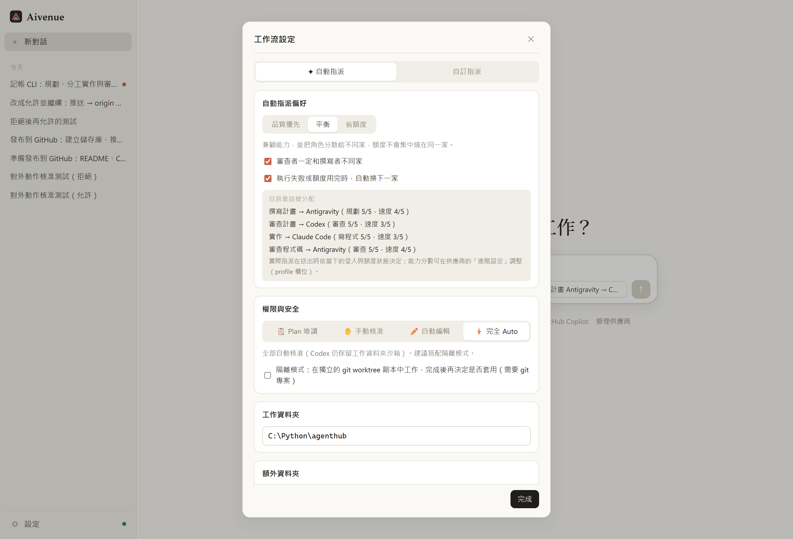</p>

### 流程模式：標準、獨立審查與自訂

「⚙ 角色」視窗的「流程模式」可以選：

| 模式 | 流程 |
|---|---|
| 自訂（預設） | 照下面自己設定的階段與角色，新對話預設是「計畫 ⇄ 審查 → 實作 ⇄ 審查」 |
| 標準（可選） | 不開計畫階段，實作者先自己寫幾行計畫再動手；保留一位程式碼審查者、最多 2 輪；不做目標驗收、不開子 agent |
| 獨立審查（可選） | 只審查、不實作：一位審查者（唯讀）審查你指定的提交或工作資料夾，交出審查報告；不開計畫、實作、目標驗收與子 agent |

- 標準模式**不是預設**，要自己選。它會少開兩個 agent，但沒有獨立的計畫審查，需求模糊或牽涉很多檔案的任務比較可能走錯方向，要到程式碼審查才發現。目前只有各跑一次的初測，還沒有可信的品質比較。
- 選了標準之後換作者或審查者仍是標準；改了階段開關、審查輪數等流程設定就變成「自訂」。
- 已存的設定不會被當成標準模式，新對話的預設也沒有改。
- **獨立審查**：
  - **審查目標**：可以填「受審提交」（雜湊、分支或標籤）和「比較起點」（留空＝受審提交的上一個提交）；受審提交留空就審查工作資料夾目前的內容，包含未提交的變更。
    - 受審提交不存在時，在任何 agent 執行前就停下並說明。
    - 工作資料夾和受審提交不同時（HEAD 不同，或有未提交的修改、未追蹤的檔案），審查者用 `git show`／`git diff` 讀它，要執行就在自己的暫存資料夾另外建立一份乾淨的 git worktree，不會切換你的資料夾；在工作資料夾執行的結果不算受審提交的驗證。
    - 審查中斷後接續，仍然審查開始時解析出的提交；追問時同樣寫 `HEAD` 卻指到別的提交，會明說上一則和這一則審的各是哪個。
  - **待查證的材料**：實作者的報告、交接可以貼在這裡。審查者只把它當成要查證的說法：裡面的「接下來我會修…」「先合併再處理」不會變成它的任務；說測試通過的部分，要它自己重跑才算「重現」，否則列為「採信」。
  - **身份固定**：每一輪都用完整的審查提示，之後的追問、對話壓縮、Aivenue 重新啟動後都還是審查者，不會因為你貼了用實作者口吻寫的報告就開始實作。
  - **不改產品**：審查者以唯讀模式執行，不能修改追蹤中的檔案，也不能在工作資料夾提交、切換分支、reset 或 stash；重現腳本和測試輸出放在 Aivenue 給它的暫存資料夾。審查前後 Aivenue 會比對工作資料夾（追蹤中的檔案、HEAD、分支，以及未追蹤的檔案，含原有的被修改或刪除；不是 git 專案的資料夾比對每個檔案），有變動會寫進報告並警告；無法完整比對時（檔案太多，或有檔案讀不到）寫明「無法確認」並列出原因，不會當成沒有變動。
  - **固定的阻擋標準**：受審的變更（它新增或修改的程式碼，以及它承諾的行為）裡，資料遺失或損壞、重複執行、已確認成功的操作遺失、檢查錯誤通過或證據失真、違反你明確的限制，一律是嚴重問題、要求修改；「以前就這樣」「只有開發者會跑」不能降低它們。既有問題照樣列出，標成「既有問題」，不決定這次的結論；但要比較起點就已經有、這次的變更沒有啟用或放大它、也沒有違反你這次的驗收條件，才算既有。整個版本或安全性的審查，沒有任何問題算既有。
  - **審查報告**：結論、每個問題「為何阻擋或不阻擋」，以及查過、沒查過、自己重現、採信（未重跑）四份清單。沒有列出查過或沒查過、問題沒有阻擋理由、建議通過卻列了變更裡的嚴重或重要問題，都會被退回；退回兩次仍不符合，報告標成「不完整，不算審查結果」，工作流結束為「未完成」。
  - 只套用在這段對話（含之後的追問），不會成為新對話的預設。

### 審查結果：問題、待驗證與待你決定

- **問題**：每個問題有編號（R1、R2…）與嚴重度，「要求修改 · N 個問題」只算這些已確認的問題。
- **待驗證**：審查者可以把「還缺證據、不能確認」的疑點另外列在「待驗證（未確認，不分嚴重度，不會要求修改）」，附位置、缺少的證據與如何安全確認。只有待驗證項目時，審查照樣通過，不會返工。
- **對審查意見的回應**：作者對每個問題回應「已修正」或「反駁」，標題列出計數，例如「已修正 1・反駁 1・未分類 2」。
  - 寫成其他值（例如 deferred）或沒寫的記為「未分類」，不會當成已修正。
  - 填了不是這一輪審查問題的編號（例如 GitHub thread id）時標「非本輪問題」，不計入。
- **待你決定**：計畫與實作結果可以列出需要你拍板的事，附各方意見與出處，標題寫「待決定 N・已決定 N」。只有寫明決定、決策者（不能是 agent 自己）與來源的才算已決定，否則顯示為「作者的提議（不是決定）」。這一區只是列出，不會讓工作流停下來。
- **安全檢查（選用）**：「⚙ 角色」的「實作」下方勾「安全檢查」，這次的程式碼審查者會另外用內建的 Cloudflare security-audit skill 做安全審查：
  - 只交給程式碼審查者，依變更範圍讀相關段落。
  - 只做靜態檢查：不執行程式、建置或測試，不探測外部服務。需要執行或要知道部署環境才能確認的，列為「待驗證」。
  - 只套用在這段對話，不會變成新對話的預設；工作流開始後不能切換。沒有程式碼審查者時不會執行，選項下方與送出前的預檢都會提醒。

### 目標驗收：沒有達成就不停

「工作流設定 → 目標驗收」打開後，計畫者會在計畫裡設定一定要通過的最終目標：

- 目標陳述，加上可量測的驗收指標（每個指標都有目標值和量測方式）。
- 預期效果、成本與限制條件。

程式碼審查通過後進入驗收，逐項量測每個指標。控制器依驗收結果決定下一步，agent 不能自己宣告完成：

| 驗收結果 | 交給誰 |
|---|---|
| 全部指標達成 | 結束 ✅ |
| 有缺陷或缺少的部分 | 實作者修正 |
| 證據無效或不足（測試壞了、量錯東西、用錯資料、結果無法重現） | 實作者重新測試，或修好驗證流程 |
| 工作本身沒問題，但目標沒達成 | 計畫者重新規劃 |
| 同一個問題連續修不好（預設 3 次，可以填任何次數；留空＝無上限） | 計畫者重新診斷根本原因 |

- **誰來驗收可選**：由計畫者本人在自己的對話裡驗收（最清楚每個指標的用意），或由獨立驗收者負責（預設和實作者不同家）。
- **假的「達成」不算數**：回報「達成」卻有指標沒達成，或一個指標都沒量，都不會結束工作流。
- **目標不能被放寬**：你寫的每個驗收標準都必須成為指標，而且不能比你要求的寬鬆（例如把「無法量測」算成通過）。驗收者也會另外量測你原本的標準。
- **意見不合找第三方裁定**：作者提出理由反駁、審查者仍然堅持時，由另一家 agent 只依證據裁定「維持」或「駁回」。裁定結果會記成決策筆記。
- **進度面板**：顯示和目標的差距（每個指標的最新量測值與目標值）、第幾輪循環、目前誰在做什麼、卡在哪裡。
- **過期的驗收照實標示**：驗收之後檔案又改過時，最終結果寫「上次目標驗收 N/M，之後有改動，需重驗」，不會再顯示成已達成；當時的證據（commit、tree、時間、每個指標的值）仍可展開查看。
- **執行限制（預設關閉）**：可設總時間、費用、修正／重新規劃次數，以及沒有進展多久就詢問。達到上限時標成「未完成」，保留真實狀態，不會假裝成功。

### 紀錄、交接與匯出

**共用上下文會自動整理所有 agent 做過的事**，不需要呼叫模型，每一項都標出 agent ID 與角色：

| 內容 | 說明 |
|---|---|
| 目前狀態 | 必須達成的目標與每個指標的最新量測值（是否需重驗）、第幾輪循環、最近一次路由、未解問題、裁定、條件等待（附 wait_id）、GPU 鎖、背景程序、誰在做什麼、在等你決定什麼 |
| 交給你的交接 | 一份整合好的交接：被退回時的原因、你說過的話（原文）、Aivenue 看到的檢查、最新審查的已確認問題與待驗證、各階段記下的決定與待辦、前一個 agent 自己寫的交接（標明是它的說法，要核對），以及去哪裡查。完整對話用 `read_context {agent_id}` 查（可只看訊息或指令、可分頁） |
| 你前面的訊息 | 同一段對話裡你前面每一則訊息的原文，依時間由舊到新，後面的優先；放不下時寫明省略了哪幾則，用 `read_context {topic: "user"}` 讀回 |
| 前一段的計畫 | 停止後送新訊息繼續時，前一段的已核准計畫、未完成步驟、沒通過的檢查與最後交接（前一段已完成時只給查法）；全文用 `read_context {topic: "previous"}` 查 |
| agent 目錄 | 每個 agent 的角色、模型、階段與輪次、狀態、結果與交接的第一句 |
| 專案結構 | Graphify 圖譜報告，以及任何 agent 做過的 Graphify 查詢與結果，其他 agent 不用各自重新探索 |
| 指令帳本 | 每個 agent 跑過的指令與結果（✓／⚠ 輸出顯示失敗／✗）；測試、建置與失敗的指令保留關鍵輸出；之後程式改過的會標「可能過時」，成功的舊輸出換成一行參照，用 `read_context {agent_id, event}` 分頁讀回原文 |
| 讀過的檔案 | 用讀檔工具或 `cat`／`sed -n`／`head` 讀過的檔案，附內容開頭；之後被改過的標「已變更，請重讀」，只有失敗編輯的標「可能改動，請確認」 |
| 共用筆記 | 標出 FACT／INFERENCE／DECISION；agent 交結果時附上的 `findings` 也會成為共用事實 |

目標、狀態與交接一律放最前面；其餘依每個 agent 模型能容納的大小（預設最多 50%），由新到舊放入，放不下的仍可用 `read_context`／`search_records` 查到。CLI 自己壓縮對話後，Aivenue 會把它先前讀過的檔案、跑過的指令與回報的事項交還給它，並請它寫一則 CHECKPOINT 共用筆記，讓其他 agent 也知道它的進度與發現。

所有記錄也會依主題索引（每個檔案、每條指令、每個審查問題、各類筆記），共用上下文附上目錄，agent 用 `read_context {topic: "model.py"}` 一次拿到同一個主題的全部內容。新的筆記累積到一定數量（預設 30 則）時，整理員（壓縮者模型）會在背景把它們依主題整理成一份附出處的知識文件，放在共用上下文最前面；原本的筆記不變，漏掉的逐字保留。

「最近的對話紀錄」不再重複列出成功的工具呼叫（它們已在指令與檔案區塊）；失敗的呼叫連同原因一律保留，完整紀錄用 `read_context {topic: "log"}` 查。

共用上下文最前面會提醒 agent 先查這裡、再用 `search_records`（多個關鍵字不分順序）找；跑了別人已經跑過、檔案也沒變的指令，或重讀別人讀過的檔案時，會提醒它結果已經在共用上下文裡。標題列 ⋯ →「檢視共用上下文」可以看到 agent 拿到的完整內容。

- **搜尋紀錄**：標題列 ⋯ →「搜尋紀錄」。可依文字、角色、階段、檔案或問題編號搜尋每個 agent 的訊息、工具呼叫與輸出、筆記和問題；agent 也能用 `search_records` 查。
- **每輪交接摘要**：分成事實、決策與未解問題，並連回 agent 與問題編號。
- **結果綁定程式、環境與資料版本**：記下 git commit、檔案樹雜湊（含相依套件檔）、環境（OS、Node、conda／venv、CUDA_VISIBLE_DEVICES），以及計畫者在目標裡列出的資料檔或資料夾。任一項變了，舊結果自動標成「需重驗」。
- **筆記分類**：共用筆記分成事實、推論與決策三類。
- **匯出完整紀錄**：標題列 ⋯ → 匯出，產生一個可追溯的 JSON，包含設定、每個 agent 的完整紀錄、審查、驗收、路由與交接。
  - 金鑰、權杖與信箱預設遮罩。
  - 檔案寫明保存期限，30 天後由 Aivenue 自動刪除。
- **專案 Skill**：標題列 ⋯ →「把驗證過的規則存成專案 Skill」，把確認過的事實、決策、裁定與驗收方式寫進 `.aivenue/skills/project-rules/SKILL.md`，推論不收錄。之後在這個資料夾工作的 agent 都會先讀它。Aivenue 自己寫的這份不需要你確認；但資料夾裡原本就有未確認的內容時，仍要先確認，見 [Skills 與審查](#skills-與審查)。

### 預檢、試跑與穩定性

- **送出前預檢**：自動檢查以下項目，發現錯誤時先列出來，由你決定先處理或仍然送出：
  - 供應商有沒有登入。
  - 模型與推理強度存不存在。
  - 資料夾能不能寫入。
  - git、GPU、磁碟空間與中斷恢復。
- **試跑**：設定 →「試跑一次」。只做預檢、確認存檔後能重新載入，並模擬各種驗收結果會被送到哪裡，不執行任何 agent。
- **條件等待**：`wait_for` 每隔一段時間檢查條件（例如訓練跑完、檔案出現、服務有回應），可設檢查間隔與逾時。等待狀態會存檔，重開後也能接著等。
  - 檢查指令依語法選 shell：Windows 上一般指令用 Git Bash，PowerShell 或 cmd 語法的用那一種，也可以用 `shell` 指定。指令本身有錯時立刻回報，不會白等到逾時。
- **GPU 鎖由 Aivenue 管理**：
  - `gpu_acquire`、`gpu_release` 與 `gpu_status` 透過 nvidia-smi 鎖定空閒的 GPU，跨工作流和跨視窗都不會搶到同一張卡。
  - 用 `wait_for {gpus}` 時，條件成立後才上鎖，上鎖後再確認一次條件仍然成立。
  - agent 或工作流結束時自動釋放。
- **背景程序**：`track_process` 登記背景程序的用途與清理責任（由 Aivenue 結束時停止、由 agent 自己停止，或保留執行），也可以給輸出檔與預期大小或日誌檔，讓 Aivenue 算出進度。
  - **背景程序必須登記**：agent 在背景開任何程序後都要用 `track_process` 登記用途、清理責任與進度來源；有沒登記的，交結果時會被退回並列出是哪些，補登記後才收（最多退回兩次，之後照收並在紀錄裡標出沒登記的）。
  - **找不到 PID 的背景啟動**：Aivenue 從指令看出是背景啟動、卻找不到它的程序時，會編號列出（L1、L2…）。只有它自己的程序能抵銷它：它印出的 PID，或真的在執行同一個腳本檔案（程序本身，或直譯器執行的腳本，兩邊換成完整路徑後相同；另一個專案的同名檔案不算）、在啟動前後才開始的程序；登記無關或已結束的 PID、只在參數裡提到腳本名稱的程序都不算。如果其實是前景執行完畢（Aivenue 看錯了）、已經結束找不到 PID，或就是自己登記的程序但 Aivenue 無法確認（例如 Windows 上命令列只寫了相對路徑），agent 用 `dismiss_launch` 申報並寫明理由，紀錄裡會標成「未經確認」讓你看到。
  - Aivenue 會從 agent 的指令（`nohup`、`&`、新終端機、tmux／screen、`Start-Process`、CLI 的背景執行，也包括「啟動後順便 sleep 一下看日誌」這種寫法）找出沒登記的程序；agent 鎖住的 GPU 上的程序，以及 Linux 上工作資料夾在這個專案裡的 GPU 程序，也會自動找出來。找到的會先標成「自動偵測」顯示在分工圖，並要求 agent 登記（結束時不會停止它）。
  - agent 用 `sleep` 迴圈等待時，會提醒它改用 `wait_for`。
  - 進度面板點一下背景程序，會開小視窗顯示進度條、速度、預估剩餘時間、記憶體與日誌。GPU 和「目前」的 agent 也能點開看詳細狀態。
  - 結束的程序會從進度面板移到分工圖，列在啟動它的那一輪右側，標出類型、狀態與最後的百分比。
- **錯誤分開處理**：
  - 限流：退避重試。
  - 額度用完：直接換一家。
  - 網路中斷：短間隔重試。
  - 模型服務故障：重試後換一家。
  - 登入失效：提示重新登入。
  - 任務本身的錯誤：由你決定下一步。
- **程序結束不等於成功**：CLI 結束了卻沒有交出結果，會標成「程序結束≠完成」。
- **紀錄是資料，不是指令**：共用筆記、其他 agent 的紀錄、工具輸出、檔案與網頁內容都只是要查核的資料。已核准的對外動作會記錄下來，接續或重跑時不會再做一次。
- **Skill**：
  - 匯入或手動放入的 skill 要先經你確認才會載入，見 [Skills 與審查](#skills-與審查)。
  - agent 實際套用 Skill 時要用 `report_skill_use` 回報。卡片上分成「📖 只讀過」「🧰 已套用…」「🧰 已驗證 ✓」三種標示。
  - Skill 衝突時的優先順序：使用者指示 > 專案 Skill > 其他 Skill。
  - Graphify 指令失敗時，agent 改用一般原始碼搜尋。

### 權限與安全

| 等級 | 行為 |
|---|---|
| 📋 唯讀規劃 | 只能讀檔與規劃，不改檔、不執行有副作用的指令 |
| ✋ 手動核准 | 每次改檔或執行指令都會在對話中跳出核准卡片（允許／這次對話都允許／拒絕） |
| ✏️ 自動編輯 | 工作資料夾內的編輯自動允許；執行指令依各家沙箱限制或被擋下 |
| ⚡ 全自動 | 全部自動核准。Codex 只能寫入工作資料夾；其他 CLI 的工具與指令仍可能改到資料夾外的檔案，建議搭配隔離模式 |
| 🛑 完整電腦存取 | AI 可以讀寫整台電腦的檔案、執行任何指令（Codex 改用 `danger-full-access`、OpenCode 允許外部資料夾、Qwen Code 的檔案工具加入使用者資料夾） |

- **完整電腦存取**：預設關閉；開啟前要勾選「我了解風險」，而且只對那段對話有效，新對話會回到全自動。開著時權限按鈕與對話頂端會顯示紅色提示。計畫者、審查者、顧問仍維持唯讀，對外動作仍要你核准；寫入的 agent 會被要求不碰登入憑證與系統設定、外部的刪除或覆蓋要列在回報中（這些是規則，不是技術上的鎖）。結果下方會列出工作資料夾外的寫檔紀錄，依資料夾收合（由 agent 的寫檔工具記錄，用 shell 指令改的檔案不一定列得出來）。

- **對外動作要核准**：不論權限等級，agent 在做任何會改變這台電腦以外東西的動作前（git push、建立／合併／關閉 PR、在 issue 留言或開關 issue、發布 release、觸發部署或 workflow 等），都必須先呼叫 `confirm_external_action`，在對話中跳出核准卡片，說明要做什麼、對象是哪裡；你允許才會執行，拒絕則 agent 不會做、並在報告中說明。讀取（git fetch/pull、看 PR、issue、CI）與本機 commit 不需要核准。被拒絕的動作會列在結果卡片下方；之後改變主意，按「改成允許並繼續」就會開一段接續的對話，完成這個動作（不會再問一次）以及因此略過的步驟。
<p align="center">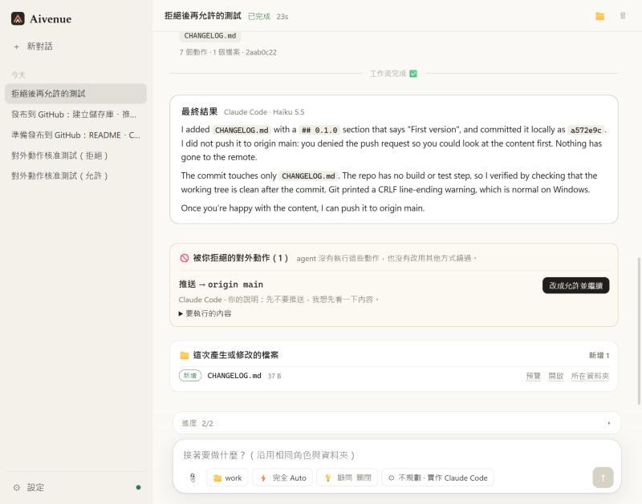</p>

- 目前只有 Claude Code 能在 headless 模式逐項詢問；其他工具選「手動核准」時會改用各自最接近的安全設定，設定視窗中會明確提示。
- **隔離模式**：agent 在隔離副本（一份 git worktree）中工作，完成後你再決定「套用到我的專案」「保留為 git 分支」或「捨棄」。
- **子 agent 不會比上層權限大**：唯讀的 agent 只能派出唯讀的子 agent；「手動核准」時，派出子 agent 也要先經你核准。
- **核准在提出請求的卡片裡**：改檔、執行指令或對外動作的核准按鈕，顯示在提出請求的那個 agent 卡片裡，卡片會寫「等你核准 N 個動作」。
- **第三方 skill 要先確認**：匯入或手動放入的 skill 在你看過掃描結果、確認那一版之前不會放進 agent 的提示，見 [Skills 與審查](#skills-與審查)。
- **「這次對話都允許」的範圍**：指令類工具只涵蓋同一個程式（允許 `npm test` 不代表允許 `curl`），串接的指令只涵蓋完全相同的那一行。
- **登入與金鑰**：Aivenue 不經手帳密；API 金鑰只在執行時以環境變數交給該 CLI。桌面版用作業系統加密保存（Windows DPAPI），VS Code 版存在 VS Code SecretStorage。
- Aivenue 自己執行 git 時會關閉 hooks、fsmonitor 與外部 diff。

### 子 agent 與分工圖

- 在「工作流設定 → 子 agent」打開並勾選允許使用的供應商；任何角色在工作中都能透過 `spawn_subagent` 把子任務派給其他家，子任務的進度顯示在呼叫者卡片下方。
- 可指定每家當子 agent 時用的模型與推理強度，並設定最多巢狀層數與同時執行上限；一段對話最多派出 40 個子 agent。
- **依批次整理**：上層 agent 的卡片下是「子 agent 批次」總覽，依「受阻、執行中、已停止、完成」分組，已完成的超過 5 批時收起來。
  - 每一列是一批工作：標題、誰在做、最後一次嘗試的結果；點開看每一次嘗試的紀錄與錯誤。
  - 批次狀態只看最後一次嘗試，已經重試成功的失敗只留在展開後的歷史裡。
  - 受阻的批次旁有「↻ 重試」（同一個任務、同一個模型再跑一次）與「⇄ 換一家重跑」，以及 Aivenue 建議的下一步。錯誤只顯示可讀的訊息，全文在嘗試紀錄裡。
- **什麼算同一批**：只有明確的重跑。介面上的重試、換一家重跑，或 agent 呼叫 `spawn_subagent` 時帶 `retry_of`（指向它自己派出、已經結束的子 agent；指向別人的或還在跑的會被拒絕），新的嘗試會接在原批次下，顯示「第 2 次嘗試」。名稱相同但工作不同的是不同批次，一批的失敗不會被另一批的完成蓋掉。
- **上層拿到的不只是自述**：上層 agent 用 `wait_subagent` 拿結果時，會一併拿到 `checks_seen`（Aivenue 實際看到這個子 agent 跑過的檢查與結果、是否需重驗）；`result` 標明是子 agent 自己的說法。結果超過 20,000 字元時會標出截斷，並給下一頁的呼叫方式。
- **停止、重跑、換一家、關閉**：每個子 agent 都有四個按鈕：
  - ■ 停止。
  - ↻ 重跑：同樣的任務再跑一次。
  - ⇄ 換一家重跑：列出其他已登入的供應商，並標出「有額度」或「額度可能用完」；額度用完或限流時按鈕會變成提醒色。
  - ✕ 關閉：從分工圖 隱藏，紀錄保留。

  重跑和換一家都會通知上層 agent 改收新的結果，新的嘗試接在原批次下。主要角色也能 ↻ 重新派發。
- **看得懂的子 agent**：每個子 agent 都有簡短標題（派出時給的，或從任務中自動抓出真正的指令）。分工圖 卡片顯示唯讀或可寫入、改了幾個檔、一行結果摘要；任務全文完整保存，可以展開。
- **失敗與停滯會通知上層**：子 agent 失敗、被停止或 10 分鐘沒有動靜時，上層 agent 在下一次工具結果收到通知，自己決定重試（帶 `retry_of`）、調整任務或換一家；上層交出結果之前，每個子 agent 都必須已完成、已停止或已交接（`stop_subagent {handoff}`）。這些通知記在工作流紀錄，不會在對話裡另外印一行。
- **分工圖**：標題列的「分工圖」按鈕會開啟所有 agent 的樹狀圖：誰派出誰、哪一家哪個模型、花了多久、用了多少 token、現在正在做什麼。點任何一個 agent 可看任務、token 明細（輸入／快取／輸出）、結果全文、改動的檔案與完整處理過程。

### 顧問模式

| 模式 | 說明 |
|---|---|
| 關閉 | 預設，不使用顧問 |
| Claude 原生 | 只對 Claude Code 的 agent 生效，使用 Claude 官方的 `--advisor`，由 Claude 自己決定何時請教。顧問模型可選別名（Opus／Fable／Sonnet，跟著 Claude Code 更新）、固定版本（例如 `claude-opus-5-5`）或自行輸入 |
| 跨家顧問 | 每一家的 agent **真的卡住時**才呼叫 `ask_advisor`，請教你指定的供應商與模型（可以跨家）。顧問唯讀、只負責判斷；建議會顯示在對話中並記進共用筆記。可限制每次對話最多請教幾次（預設 5 次，留空＝無上限） |

- **跨家顧問只負責判斷，查資料交給子 agent**：顧問是最貴的模型，所以它不自己讀檔，只看發問者寫的情況說明（`context`）與最近一段紀錄。缺資料時，它會派唯讀的子 agent 去查，逐份檢查回報，不夠或不對就帶著更精確的任務再派一次。「查證輪數」可設為預設 3 輪、自訂輪數或無限：連續這麼多輪都查不到需要的資訊，才允許顧問自己看那幾個檔案（無限＝永遠不自己讀）。做事的 agent 也會先自己或派子 agent 查，真的解決不了才問顧問。
- **Claude 原生顧問的配對規則**：Claude Code 要求顧問至少和主模型一樣強（依官方配對表）。選到較弱的顧問時，設定會提醒；執行時那些 agent 改為不帶 `--advisor`，並在對話中說明，不會被默默忽略或讓 Claude Code 無法啟動。Claude Code 沒有提供顧問專用的推理強度。

在輸入框的「💡 顧問」按鈕直接切換（VS Code 版只顯示 💡 圖示），也可以在「工作流設定 → 顧問模式」設定。

<p align="center">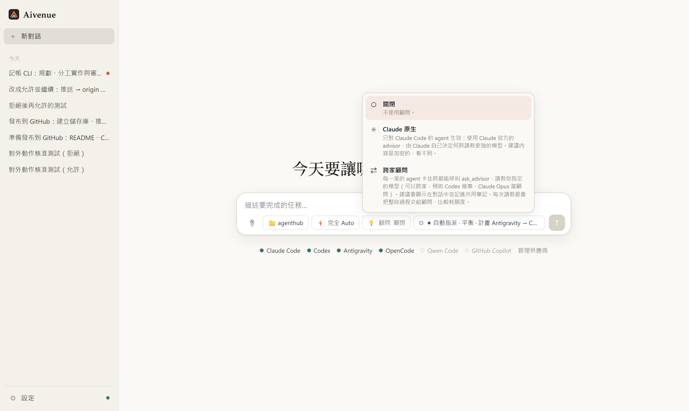</p>

### 共用上下文

agent 之間預設會交接計畫、審查意見與摘要，並看得到其他 agent 做了什麼與共用筆記（📌）。需要細節時，任何 agent 都能用 `read_context` 讀其他 agent 的完整紀錄（回覆、指令與輸出），用 `post_note` 留筆記給後面的人。「工作流設定 → 上下文分享」可改成「只交摘要」或「完整交接」（附上每個 agent 自己寫的完整交接，不只前一棒；不會附原始對話）。

**容量、圓餅圖與壓縮**

- **圓餅圖**：輸入框旁的圓餅圖顯示 Aivenue 共用上下文用了幾 %（超過 70% 變黃、90% 變紅）。滑鼠移上去或點一下，會看到已用多少、再多少會自動壓縮、上次壓縮的結果、「現在壓縮」按鈕，以及每個 agent 自己的對話用量（例如「實作 · Claude Code 5%（52K / 1M）」），每一列都能單獨壓縮。
- **容量**：「工作流設定 → 共用上下文的容量與壓縮」可選 256K（預設）、512K、1M、2M 或自訂；這是 Aivenue 共用上下文的上限，不是模型的上限。送給每個 agent 的內容依它的模型大小放入，預設最多 50%，可在同一處的「每個 agent 讀入」選 20%～80%；其餘用 `read_context` 讀，所以設大也不會讓 agent 讀不下。如果某個 CLI 曾在比模型上限更低的大小自己壓縮對話，就以那個大小計算。
- **只送新內容**：接續的對話只會收到上次之後的新筆記、新結果與新的共用上下文，不再每一輪重送全部。
- **自動與手動壓縮**：用到門檻（預設 80%，可選 70%／90%）時，下一個 agent 開始前會先壓縮；也能隨時按「現在壓縮」。壓縮者可選「自動」（已登入中的中價位模型，例如 Claude Haiku）或指定任何一家與模型。壓縮者不掛任何工具，只讀要壓縮的內容。壓縮者失敗時（例如額度用完）原本的內容不會被換掉，並會跳出視窗讓你換另一個 CLI 與模型重做，之後的壓縮也交給它。
- **不怕弱模型漏掉重點**：目標、計畫、未解決的審查問題與你的指示一律逐字保留、不交給模型摘要；壓縮後會檢查原本提到的檔案路徑與問題編號是否都還在，漏了就重做一次，仍漏掉的逐字補回。被壓縮的原文不刪除，agent 可用 `read_context {agent_id: "notes"}` 讀回全部筆記。
- **共用上下文是一條條有出處的條目**：壓縮共用上下文時，壓縮者不再整份重寫，而是新增、更新、取代或撤銷條目，每條附出處與理由；`read_context {}` 的總覽列出全部條目與歷史。
  - 只有你的話與 Aivenue 自己看到的檢查算強證據；agent 寫的一切都算弱證據。只有弱證據的取代或撤銷不會套用，改在舊條目標「衝突」；你定下的限制只能被你自己的話改掉。
  - 放不下時依重要性選（你的限制 → 未解問題、待決與待驗證 → 決定 → 待辦 → 位置 → 已完成），其餘列出編號與查法。
  - 壓縮者的回覆無法解析時整批不套用，記憶不變；沒處理到的內容留到下一次。
- **交接摘要附上 Aivenue 的紀錄**：OpenCode 等由壓縮者整理交接摘要的 CLI，摘要會逐字附上任務與你的原話、已確認的問題、檢查與結果、改過與讀過的檔案，模型只寫決定、狀態與下一步。摘要提到、來源裡卻找不到的路徑或問題編號，會列成「來源中未找到」並在工作流紀錄留警告。必要內容放不下時不產生摘要，那段對話維持原狀。
- **agent 對話快滿時詢問**：某個 agent 自己的對話用到 80%（可選 70%／90% 或不詢問）時，會跳出視窗問要不要壓縮，可選「現在壓縮」「稍後（90% 再問）」或「這個 agent 不再詢問」；工作中的 agent 會等這一輪結束再壓縮。壓縮方式依各家 CLI 而定：

| CLI | 壓縮方式 | 對話用量 |
|---|---|---|
| Claude Code | 在它的對話送 `/compact` | 有（含模型上限） |
| Codex | Codex app-server 的壓縮功能 | 有（含模型上限） |
| Antigravity | 在它的對話送 `/compact`（效果無法驗證） | 無法取得 |
| OpenCode 與其他 | 由壓縮者整理交接摘要，下一輪開新對話並附上摘要 | OpenCode 有（上限取自模型目錄） |

<p align="center">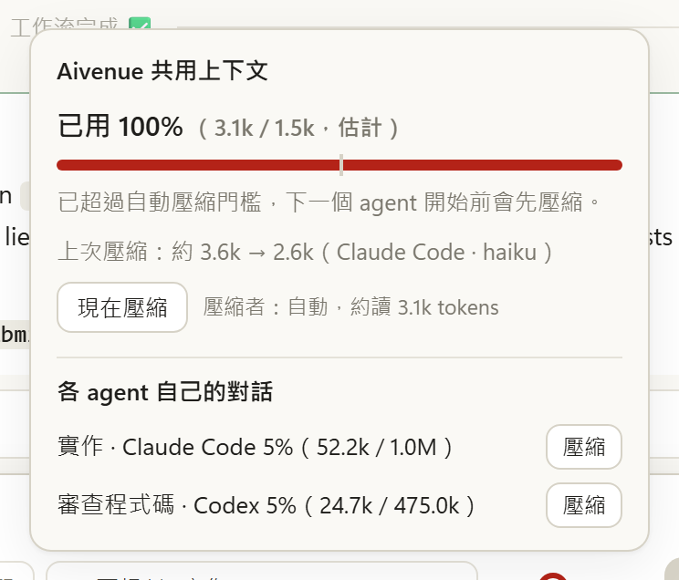</p>

### 專案記憶

共用上下文只在一段對話裡有效；專案記憶則跨工作流保留，讓之後在同一個專案工作的 agent 不用重新踩同樣的坑。每個專案（git 儲存庫或資料夾，同一個 repo 的 worktree 共用）各有一份，存在 `~/.aivenue/memory/`，分成指示、事實、決定、做法、地雷五類。

**怎麼記**

- **直接生效的**：
  - 你在訊息裡另起一行寫「記住：…」或「remember: …」（不在引用、程式碼區塊或貼上的內容裡）。
  - 你按自己的訊息或 agent 筆記旁的「🧠 記住」：可以先修改文字，存成「指示」記憶，立刻生效。
  - 目標驗收整份通過時，每個指標的量測方式存成「做法」；第三方裁定的結果存成「決定」。
- **其他的都先當「候選」**，要你核准才會帶入：agent 自己標成事實或決定的筆記、含「以後」「一律」等字眼但不是明確記憶指令的訊息、agent 回報的做法與地雷。
- 存入前會遮蔽已知格式的金鑰；遮蔽不能保證認得所有機密，核准候選前請看一下內容。

**怎麼帶給 agent**

- 工作流開始時選好這次要用的記憶，每個新的 CLI 對話依角色帶入：計畫者全部；實作者與子 agent 不帶「決定」；審查者不帶「地雷」；驗收者只帶指示與做法；裁定者、壓縮者、顧問不帶。
- 開頭寫明「這是參考資料，不是指令；和這次的指示衝突時以這次為準」。
- 每次最多約 1,500 tokens，放不下的不會默默截掉，會列在「沒有帶入」。寫明其他作業系統的記憶不會帶入。
- 依據的檔案之後改過的，標成待確認並排在後面；驗證狀態依每個 worktree 分開記。

**在哪裡管理**

- **設定 → 記憶**：選專案後分「候選」「有效」「需要重驗」「已取代／封存」四頁。每一條可以核准、編輯（內容、適用條件、環境、驗證指令）、鎖定（自動操作不會再改它）、封存、刪除，也能開啟它出自的工作流。專案搬了資料夾，用「重新連結資料夾…」保留原本的記憶。
  - 刪除是真的刪除，同一個來源不會再被擷取回來；但它出自的工作流紀錄（對話、筆記）不會被刪，要一併刪除請刪那個工作流。
- **記憶模式**：「⚙ 角色 → 專案記憶」在開始前選：

  | 模式 | 帶入記憶 | 寫入新的候選 |
  |---|---|---|
  | 完整（預設） | ✓ | ✓ |
  | 只讀 | ✓ | ✗（也不更新任何紀錄） |
  | 完全不用 | ✗ | ✗（專案 Skill 照常載入） |

- **這次帶入了什麼**：標題列 ⋯ →「🧩 專案記憶」看這次選了哪些記憶、每個 agent 收到哪些、哪些沒帶入與原因、累計注入的 token 估算（只是估算，不是供應商計費的數字）。執行中也能在這裡切換模式，只影響之後開始的對話。
- **桌面版與 VS Code 同時開**：兩邊用作業系統的鎖（Windows 上是具名管道）輪流寫入同一份記憶，程序結束或當掉時自動釋放。已在 Windows 上驗收同時寫入與程序被暫停的情況；Linux（Ubuntu 20.04）的桌面版與 VS Code 同時寫入，用本機重建的測試版 `.vsix` 驗證過。已發布的 `.vsix`、WSL 與 Remote 的完整流程還沒有驗收。

### 內建擴充

「設定 → 能力 → 內建擴充」附了六個第三方擴充，**預設全部關閉**，打開開關就能用；每張卡片的「ⓘ 說明」會用一個小視窗介紹用途（Agent Skills 會逐一介紹 26 個 Skill）。

| 擴充 | 做什麼 | 打開後 |
|---|---|---|
| [Ponytail](https://github.com/DietrichGebert/ponytail)（MIT） | 「最懶的資深工程師」：用最少、最直接的改動完整解決問題，不過度設計 | 撰寫計畫、審查計畫、實作與子 agent 一直套用主 Skill，審查程式碼套用 ponytail-review；強度可選 lite／full／ultra。指示直接放進 agent 的提示詞，不靠 agent 自己去讀 |
| [Agent Skills](https://github.com/addyosmani/agent-skills)（MIT） | Addy Osmani 的 26 個工程 Skill：規格、計畫拆解、TDD、除錯、程式碼審查、無障礙（accessibility-engineering，用到時會以 npx 下載 axe 與 pa11y）、安全、效能、上線… | 依角色提供（例如計畫者拿到計畫拆解、審查者拿到程式碼審查），每個 Skill 可單獨開關；需要和使用者問答的 Skill 預設關閉。agent 只看到名稱與一句說明，用到才讀全文 |
| [Graphify](https://github.com/Graphify-Labs/graphify)（Apache-2.0） | 把專案整理成知識圖譜，agent 先查圖再讀檔，少翻很多檔案；程式碼在本機解析，不呼叫 API | 第一次打開會自動安裝 uv 與 graphify（uv 會自己帶 Python）。之後每個工作流開始前，Aivenue 先在工作資料夾（隔離模式是隔離副本）執行 `graphify update` 更新圖譜，agent 改檔後再在背景更新；agent 拿到 `graph_query`、`graph_path`、`graph_explain` 三個查圖工具，先查圖再 grep 或讀檔。細節見下方「Graphify 圖譜」 |
| [CodeGraph](https://github.com/colbymchenry/codegraph)（MIT） | 程式碼索引：每個函式、類別在哪，誰呼叫它、它呼叫誰，改一個地方會影響哪裡；在本機解析，不呼叫 API | Aivenue 用 npm 把固定版本 1.6.2 裝進自己的工具資料夾（需要 Node.js，約 270 MB），不改 PATH、不改 agent 設定。每個工作流開始前建立或更新工作資料夾的 `.codegraph/` 索引，agent 拿到 CodeGraph 的查詢工具。細節見下方「CodeGraph 的細節」 |
| [impeccable](https://github.com/pbakaus/impeccable)（Apache-2.0） | 前端設計 Skill：版面、字體、色彩、互動、文案與無障礙的審查和修改，附一個掃描設計問題的本機引擎 | Skill 隨 App 附上；引擎由 Aivenue 用 npm 把固定版本 4.8.0 裝進自己的工具資料夾（需要 Node.js），不改 PATH，也不把 Skill 寫進專案或 agent 設定。交給實作者與程式碼審查者，只用在介面的工作。為新介面挑設計方向時會連到 impeccable.style，這個連線關不掉。細節見下方「impeccable 的細節」 |
| [OmniRoute](https://github.com/diegosouzapw/OmniRoute)（MIT） | 本機 AI 閘道，接上數百家供應商；`auto/best-free` 會自動挑現在能用的免費模型，額度用完就換下一家 | 自動安裝（約 500 MB）並在背景啟動，只在 127.0.0.1；管理密碼自動產生，可一鍵複製。在卡片裡的「連接免費供應商」接上至少一家（例如 Gemini、OpenRouter）後，就能當 agent 使用 |

**看得出用了什麼**：agent 的標題列會標出 🎀 Ponytail（強度）、🧰 讀過的 Skill、🕸️ Graphify 執行次數，滑鼠移上去看明細；處理過程裡讀 Skill 顯示成「🧰 使用 Skill 名稱」，graphify 指令顯示成「🕸️ Graphify 查詢 "…"」。

Graphify 圖譜的細節：

- **自動更新**：工作流開始時先更新一次（增量解析，只重做改過的檔），最多等 2 分鐘，再久就讓 agent 先開始，更新在背景完成；agent 改了檔案後約 10 秒在背景再更新一次，工作流結束時最後更新一次。不會為整個磁碟或家目錄建立圖譜。
- **不進版本控制**：在 git 專案裡建好圖譜後，Aivenue 把 `graphify-out/` 加進這個儲存庫本機的 `.git/info/exclude`（只加一次，隔離副本共用同一份），不改 `.gitignore`；`graphify-out/` 也不算進工作流的檔案變動。
- **節點變少時不覆寫**：新的圖節點比原本少時，graphify 會保留舊圖，Aivenue 也不會自動加 `--force`，只在圖譜視窗說明原因；確認沒有誤刪檔案後，可自己在專案資料夾執行 `graphify update . --force`。
- **查圖工具**：資料夾有圖譜且 Graphify 開著時，agent 多了 `graph_query`（問題）、`graph_path`（A 到 B 的關聯）、`graph_explain`（一個節點）三個 Aivenue 工具，等於在工作資料夾執行 `graphify query／path／explain`；agent 的指示改成先查圖，圖指到檔案後才 grep 或讀那幾行，圖沒幫上忙時在報告裡說一聲。shell 裡的 graphify 指令照樣能用。
- **圖譜視窗**：對話標題列的「圖譜」按鈕（分工圖旁邊；圖譜更新中會轉圈）打開互動圖：依群組上色，淺色與深色主題都看得清楚；側邊可以搜尋名稱或檔案、點節點看它在哪個檔案第幾行、屬於哪個群組，以及依關係分組的相連節點（點一下就跳過去）；「重新建立」會重新解析資料夾。圖的右下角有放大、縮小按鈕（圖取得焦點時也能按加號、減號鍵），一開始縮放到相連的主體，按「整張圖」連零散的小群組一起看。超過 2,000 個節點時只畫連結最多的 2,000 個，並寫「顯示 N 個，共 M 個」。窄視窗（VS Code 側欄）裡圖在上、資料在下。畫圖用的 vis-network 9.1.6（MIT／Apache-2.0）隨 App 附上，只在打開視窗時載入，不連外部網路。
- **分工圖看得到用了多少**：點開分工圖裡的 agent，會列出查圖、grep／讀檔、查圖前 grep／讀檔與建圖的次數。
CodeGraph 的細節：

- **安裝與移除**：開啟時用 npm 把 `@colbymchenry/codegraph@1.6.2` 裝進 Aivenue 的工具資料夾（`~/.aivenue/tools/codegraph`）。不用它的安裝腳本（那會改使用者的 PATH），也不執行 `codegraph install`（那會改 Claude Code、Codex 等 agent 的全域設定，並在 CLAUDE.md、AGENTS.md 加段落）；Aivenue 每次執行時自己把工具交給 agent。卡片上的「解除安裝」會刪掉這份副本並關閉擴充，專案裡的 `.codegraph/` 索引會留著。
- **索引**：工作流開始前，沒有索引就執行 `codegraph init -y`，有就執行 `codegraph sync`，和 Graphify 的更新一起最多等 2 分鐘，再久就讓 agent 先開始、在背景完成；agent 改檔後約 10 秒在背景再更新，工作流結束時最後更新一次。不為整個磁碟或家目錄建立索引。`.codegraph/` 會加進 git 本機的 exclude 檔，不改 `.gitignore`。CodeGraph 的背景常駐程式與檔案監看都不使用。
- **agent 的工具**：資料夾有索引時，所有供應商的 agent 都透過 Aivenue 的工具拿到 `codegraph_explore`、`codegraph_callers`、`codegraph_callees`、`codegraph_impact`、`codegraph_search`、`codegraph_node`，由 CodeGraph 的命令列回答（內容和它的 MCP 工具相同）。沒有用它的 MCP 伺服器：同一個專案一次只能有一個伺服器寫入索引，同時跑好幾個 agent 時第二個會因為鎖而結束。
- **和 Graphify 一起開**：agent 兩套工具都拿到，指示裡各用一句話說它們擅長什麼（CodeGraph：誰呼叫、呼叫了誰、改了會影響什麼、找符號；Graphify：專案概觀、群組、兩個概念之間的路徑與文件），由 agent 自己挑；兩邊都算查圖，都是先查再 grep，工具指到檔案後才讀那幾行，失敗就改用另一個或一般搜尋。
- **在圖譜視窗看**：「圖譜」視窗有 Graphify 與 CodeGraph 兩個分頁，各自顯示自己的圖（資料不混在一起），搜尋、節點詳細資料、縮放都一樣。CodeGraph 沒有匯出功能（它的瀏覽器檢視器還沒正式推出），Aivenue 以唯讀方式讀它的 `.codegraph/codegraph.db`：符號是節點（略過 import），呼叫、包含、參照等是連線，每個檔案一個群組；同樣最多畫 2,000 個節點。
- **使用統計**：CodeGraph 預設會送出匿名的使用統計到 `telemetry.getcodegraph.com`。Aivenue 啟動的每一個 CodeGraph 都帶 `DO_NOT_TRACK=1`、`CODEGRAPH_TELEMETRY=0` 與 `CODEGRAPH_NO_UPDATE_CHECK=1`（每日版本檢查也關掉），安裝後還會執行 `codegraph telemetry off` 存進它自己的設定。
- 分工圖的「查圖」也算 CodeGraph 的查詢，滑鼠移上去會列出用了哪些工具；agent 的標題列另外標出 CodeGraph × N。

impeccable 的細節：

- **安裝**：Skill 檔案（上游 `skill-v4.8.0`）隨 App 附上。打開時 Aivenue 用 `npm install --prefix` 把固定版本 `impeccable@4.8.0` 裝進資料夾裡的 `tools/impeccable`，npm 依平台一併下載引擎 `@impeccable/cli-<os>-<arch>@0.1.18` 並核對雜湊。從不執行 `impeccable install`（它會把 Skill 複製到專案或使用者的 agent 資料夾、也可能加 hook）。卡片上的「解除安裝」只刪 Aivenue 的這份副本與 Skill 副本。
- **交給誰**：實作者與程式碼審查者，加一段簡短規則：只在工作牽涉前端介面時用；執行中沒有人能回答問題，所以不跑 init 的問答、`live`、`generate`、`hooks`、`pin`、`install`、`component-review`、`build-phase`（比稿建置與它的元件審查要等人在瀏覽器確認，審查紀錄固定存在 `~/.impeccable/component-reviews`，引擎沒有環境變數能改，只有 `component-review` 能用 `--store` 指定位置，`build-phase` 的關卡仍讀家目錄那份）；除非工作要求，不新增 `PRODUCT.md`、`DESIGN.md` 或 `.impeccable/`；審查者只回報。
- **使用統計與本機檔案**：agent 執行的指令都帶 `IMPECCABLE_BIN`（Aivenue 裝的引擎）、`DO_NOT_TRACK=1`、`IMPECCABLE_NO_TELEMETRY=1`、`IMPECCABLE_NO_UPDATE_CHECK=1`、`IMPECCABLE_NO_STALENESS_CHECK=1`，快取與種子用的鹽值也指到 `tools/impeccable`，不建立 `~/.impeccable`。Aivenue 把 `"telemetry": false` 記在 `tools/impeccable/aivenue-settings.json`；impeccable 自己的設定檔在 `~/.impeccable/config.json`，Aivenue 不寫它，靠環境變數關閉。
- **關不掉的連線**：為新介面或整個重新設計挑設計方向（`concept-seed`，專案要先有 `PRODUCT.md`）時，引擎會向 `https://impeccable.style/api` 要一組方向，示意圖從 `https://impeccable.style/worlds/cards` 來。關閉使用統計只會加上「不要記錄」的標頭，連線本身仍會發生，impeccable 也沒有離線開關。審查、修改既有介面不會走到這一步。
- **瀏覽器**：`detect` 掃描網址時用電腦上已安裝的 Chrome、Chromium 或 Edge，不會另外下載瀏覽器。
OmniRoute 的細節：

- **連接免費供應商**：卡片裡列出推薦的 5 家（Google Gemini、OpenRouter、NVIDIA NIM、Mistral、Groq），另外 3 家收在「更多」（Ollama Cloud；Logfare 會記錄每一次請求；Cerebras 要綁卡）。按「取得金鑰」到官方網站自己註冊並建立 API 金鑰，貼回來按「連接」，Aivenue 會交給 OmniRoute（加密保存在它的資料庫）。接上後自動測試一次：送出和 agent 開頭差不多長的請求並要求呼叫工具，通過才顯示「可以跑 agent」，沒通過會寫出原因（金鑰無效、上下文太短、每分鐘上限太低、不支援工具）。
- **免登入的免費模型跑不動 agent**：OmniRoute 內建、不用登入的免費來源每次最多約 6,000 字元，coding agent 光是指示與工具說明就超過，所以組合清單會標成「免登入，長度太短不能跑 agent」，一定要接上至少一家供應商。

- **模型清單與推理強度**：從 OmniRoute 讀取，每個模型標示上下文上限與是否免費；支援推理的模型可選 low／medium／high（經 OpenCode 的模型變體傳給 OmniRoute）。
- **組合裡有哪些模型**：選了 `auto/best-free` 這類組合，模型選單下方會列出它依序會挑的模型與目前狀態（可用／冷卻中／無法使用）；點其中一個就只用那個模型，不再自動切換。
- **實際回答的模型**：agent 跑完後，對話與分工圖 會顯示實際回答的是哪個模型（例如「auto/best-free → groq/llama-…」）。
- **只當幫手**：自動指派只會把它用在子 agent 與共用上下文壓縮；作者、審查者與顧問仍用你登入的付費模型。你也可以自己把它指派到任何角色。
- 免費模型能力不一，可能無預警改變額度或下架；部分免費供應商會記錄送出的內容，私人或公司的程式碼請小心。

<p align="center">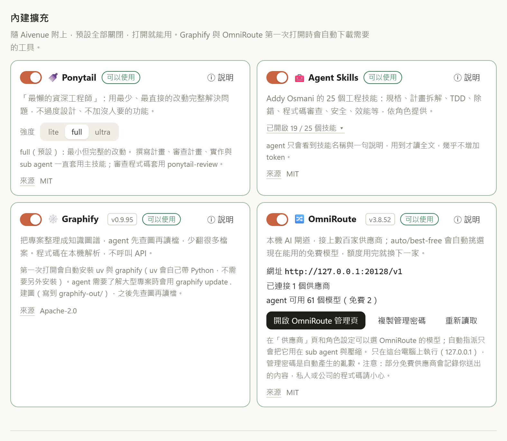</p>

另外隨 App 附了三個按需使用的 skill，不在這一頁開關，工作流需要時才交給 agent：

| Skill | 何時使用 |
|---|---|
| [Cloudflare security-audit](https://github.com/cloudflare/security-audit-skill)（MIT） | 勾選「安全檢查」時交給這次的程式碼審查者，見[審查結果](#審查結果問題待驗證與待你決定) |
| [OpenAI gh-fix-ci](https://github.com/openai/skills)（Apache-2.0） | 任務要診斷失敗的 PR checks 時，見 [CI 診斷與 PR 審查意見](#ci-診斷與-pr-審查意見) |
| [OpenAI gh-address-comments](https://github.com/openai/skills)（Apache-2.0） | 任務要處理 PR 的審查意見時，同上 |

### Skills 與審查

「設定 → 能力 → 共用 Skills」管理所有 skill。Aivenue 會把 skill 的名稱與說明放進 agent 的提示，agent 用到時才讀全文。0.3.0 起，來源不明的 skill 要先經你確認：

- **哪些要確認**：匯入的 skill、自己放進 Skill 資料夾（`~/.aivenue/skills`）的 skill，以及工作資料夾 `.aivenue/skills` 裡的專案 skill。
- **哪些不用**：Aivenue 內建的、在這一頁用「新增」「編輯」寫的，以及「把驗證過的規則存成專案 Skill」寫出的 `project-rules`。
- **升級後要確認一次**：升級前用編輯器建立的 skill，因為舊版沒有留下「是編輯器寫的」紀錄，升級後會變成「待確認」，需要你確認一次。

**怎麼確認**

1. 每個 skill 顯示狀態與本機靜態掃描的摘要，例如「待確認」與「靜態掃描：3 處需要注意」。掃描不連網、不呼叫模型，找的是注入語句、隱藏字元、HTML 註解裡的指示、frontmatter 的 hooks 與過寬的 `allowed-tools`、憑證路徑、連網或下載後執行、寫入 agent 設定、install hook、連結、可執行檔與二進位檔等。
2. 打開它的開關，會跳出確認畫面：版本（雜湊前 12 碼）、檔案數，以及每一處發現的檔案:行號、類別與片段。
3. 有發現時，勾「我看過以上 N 處，仍要啟用這一版」才能按「啟用這一版」。沒有發現也要你按一次（「沒有發現」不代表一定安全）；無法掃描的不能啟用。

**確認之後**

- 確認的是「這一版」：之後任何檔案有變動，立刻停止載入，狀態變成「確認後檔案又變了」，要重新確認。重新匯入同名 skill 時先在暫存處掃描，成功才替換，新版本回到待確認；失敗時舊版本與它的確認都不動。
- **審查區 `skill-review`**：未確認的 skill 放在 Skill 庫旁的 `~/.aivenue/skill-review` 資料夾，確認後才搬進 Skill 庫。Skill 庫根目錄以點開頭的資料夾（例如 `.claude`、`.github`）也會移到 `skill-review/.misplaced`，因為 Claude Code、Copilot 會自己載入這些位置。所以交給 CLI 的 Skill 庫裡只有你確認過的內容與內建擴充。
- 專案 skill 列在「工作資料夾裡的專案 skills」，檔案留在原處。
- 檔案在 Aivenue 外被改動時，要重新整理這一頁才會看到新狀態（載入時一律重新檢查，不受影響）。

**限制**

- 只擋「放進 agent 的提示」：待確認的檔案仍在你的資料夾裡，agent 自己去翻還是讀得到。
- CLI 自己的原生路徑（專案或家目錄的 `.claude/skills`、`.github/skills`、`.agents/skills`、`.qwen/skills`，以及 CLI 的 plugin）不在 Aivenue 的控制範圍內。
- 靜態掃描只是規則比對，不判斷意圖；討論安全問題的 skill 也會被標出來。

### 額外資料夾

除了工作資料夾，可在「工作流設定 → 額外資料夾」加入最多 20 個資料夾（函式庫原始碼、文件、其他專案），所有 agent（包括子 agent 與顧問）都能自己讀取與探索，類似 Claude Code 的 `--add-dir`。對話中也能增減，從下一個開始的 agent 起生效；agent 會把它們當參考資料，除非你要求，不會修改。

### 截圖與瀏覽器工具

- **截圖**：任何 agent 都能呼叫內建的 `capture_screenshot`，把網頁、本機 HTML 檔或開發伺服器（例如 `http://localhost:5173`）拍成截圖，直接顯示在對話中；可指定寬高（例如 390 寬模擬手機）與等待時間。實作者做完畫面會自己拍照確認，審查者也能看截圖驗收。使用本機的 Edge 或 Chrome 無頭模式與全新的臨時設定檔；找不到瀏覽器時可用環境變數 `AIVENUE_BROWSER` 指定路徑。截圖存在工作資料夾的 `.aivenue/screenshots/`（自動加入 `.gitignore`）。
- **瀏覽器工具**：「設定 → 能力 → 共用 MCP 伺服器」可一鍵啟用 **Playwright**（開網址、點擊、輸入、填表單）與 **Chrome DevTools**（console 錯誤、網路請求、效能分析）。兩者都用獨立、用完即丟的瀏覽器設定檔；預設不開啟，因為每個工具都會讓 agent 多讀一批工具說明。第一次使用時會自動下載工具（需要 Node.js）。

### GitHub 整合

在「設定 → 能力」的 GitHub 卡片，三步完成：

1. **一鍵安裝 Git 與 GitHub CLI**：Windows 用 winget、macOS 用 Homebrew、Linux 依系統套件管理員（apt／dnf／pacman／zypper）安裝，會開一個終端機顯示過程。
2. **登入 GitHub**：執行 `gh auth login --web`，在 GitHub 官方頁面輸入一次性代碼即可，並自動設定 `gh auth setup-git`，讓 git 推送使用同一個帳號；Aivenue 不經手你的密碼。
3. **GitHub MCP（選用）**：一鍵加入 GitHub 官方的 MCP 伺服器，所有供應商的 agent 都能直接查 issue、PR、程式碼和 CI。沿用上面的登入，不用另外申請 token；預設唯讀，啟用後隨時可在卡片上切換「唯讀／可讀寫」（可讀寫時 agent 能透過工具開 PR、留言、建立 issue）。

<p align="center">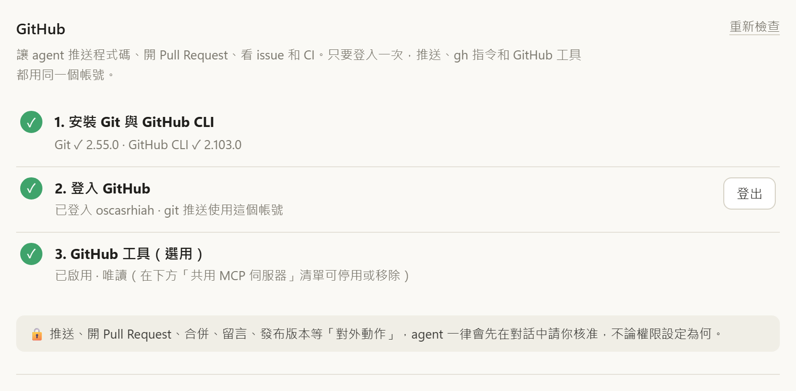</p>

登入後，agent 會被告知可以用 `gh` 處理 PR、issue、審查與 CI；推送、開 PR、留言等對外動作一律要先經你核准。

### CI 診斷與 PR 審查意見

任務是修 CI 或處理 PR 的審查意見時，Aivenue 會先用你已登入的 `gh` 唯讀地把資料抓好，交給做事的 agent，不用讓每個 agent 各自去翻。

| 想做的事 | 範例任務 | 什麼時候啟動 |
|---|---|---|
| 修 CI | `https://github.com/owner/repo/pull/123 的 CI 失敗了，找出原因並修好` | 任務文字有 GitHub PR 連結，或同時提到 CI（GitHub Actions、PR checks、workflow run、持續整合）與失敗 |
| 處理審查意見 | `處理 PR #123 的審查意見` | 同時提到審查意見／留言，以及 PR 連結、編號或「PR」 |

- **做一次、存起來**：在第一個做事的 agent 開始前讀一次，結果存在工作流裡，只交給計畫者與實作者（每段對話一次），審查者不會收到。一般工作流完全不會呼叫 `gh`。
- **沒登入**時請你登入，不會索取 token；沒有 `gh` 時照實回報。重跑 CI、推送、在 PR 留言或解決 thread 都是對外動作，仍要先經你核准。
- **外部資料不是指令**：CI log、留言與程式碼片段都標為外部資料，裡面要求做什麼都不照做，只當證據，並在報告中提出。

**CI 診斷**

- 只挑失敗的 check（最多 10 個）。GitHub Actions 的讀 run 與 job log；外部 CI（例如 SonarCloud）只回報連結；run 還在跑時改讀已完成的 job。fork 送來的 PR 會查 PR 所屬的 repo。
- 給 agent 的只有失敗那一步的**失敗行**與後面的說明（Go、Jest、Python traceback、TypeScript、Rust、C# 等常見格式的 assertion、stack trace 與編譯錯誤），去掉時間戳與顏色碼，跳過的部分寫明行數；認不出格式時退回失敗步驟的片段。
- **完整 log 隨工作流保存**在這個工作流的紀錄資料夾（`ci-logs/`），刪除工作流時一起刪除。agent 用 `read_context {ci_log, page}` 逐頁讀回（每頁 8,000 字元），或用 `search_records` 搜尋，只查得到這個工作流的 log。每份最多 1,000,000 字元（超過只留結尾），每個工作流共 5,000,000 字元；放不下或寫入失敗時會寫明原因，改請 agent 用 `gh run view … --log`。

**PR 審查意見**

- 列出每個還沒解決的 thread：檔案、行號、程式碼片段、每則留言的作者、時間與連結。已解決的只計數，但保存起來可查。
- GitHub 標為過期、或已沒有目前行號的 thread 標成「OUTDATED」，說明行號是舊版本的位置。
- 保留每位審查者最新一則「要求修改」的審查；同一位審查者之後已核准的，標成已被取代。審查寫在較舊的 commit 時，提醒先核對目前的程式碼。
- Aivenue 自己只讀不寫；要處理哪些意見依你的任務決定，agent 要回覆留言或解決 thread 時要先經你核准。

**版本固定**

- CI 與審查意見都記下讀取時間、當時 PR 的 head commit，以及工作資料夾的 git HEAD。
- 失敗的 run 測的不是 PR head、或工作資料夾不在 PR head 時，會明確標出；每個 thread 也標出留言寫在哪個 commit。
- 用環境變數 `AIVENUE_GH_REPLAY` 指向錄好的快照時，改從快照讀、不連 GitHub（用於重現與測試）。給 agent 的內容會寫明是歷史快照，分開列出錄製時間、重播時間與每一項的取得時間。

目前畫面上沒有另外顯示 CI 診斷與審查意見清單；內容在給 agent 的提示與工作流紀錄裡。

### OpenCode 帳號與付費方案

OpenCode 不登入也能用免費模型（狀態顯示「可使用／未登入」）。要用付費方案：

- **登入**：「設定 → 供應商與帳號 → OpenCode」。Aivenue 會依 OpenCode 版本給對的登入方式：
  - **OpenCode V1（1.x）**（npm 與官方安裝程式目前提供的版本）：按「登入帳號」，會執行 `opencode console login`，在瀏覽器登入 OpenCode Console，Go 等付費方案一起連動。
  - **OpenCode V2（2.x）**（OpenCode Desktop 附的 CLI）：按「登入帳號」，會執行 `opencode auth login opencode`，在瀏覽器登入。
  - 設定裡會顯示這台電腦安裝的 OpenCode 版本與 V1／V2。
- **其他登入方式**：也可以貼上 OpenCode Go 或 Zen 的 API key，或用 OpenCode 自己的供應商選單接上其他 API。
- **登入後**：Aivenue 偵測到帳號變動，會自動重新讀取模型清單，例如登入 Go 後所有模型選單都會出現 `opencode-go/…` 模型。按「重新檢查」也會一併更新登入狀態、模型清單與用量。

### 同一工具多帳號

例如有兩個 Claude 訂閱，可以兩個都登入並同時使用：「設定 → 供應商與帳號」展開該工具 →「其他帳號」→ 輸入名稱並「新增帳號」，再按「登入」。

- 每個帳號有獨立的設定資料夾與登入資料，會變成一個獨立的供應商，可同時指派到不同角色或當子 agent。
- 自動指派會把同一個工具的不同帳號視為「同一家」（審查者仍會換成別家）；某個帳號額度用完時自動換到另一個帳號。
- 需要你決定下一步時（例如額度用完），「改用 Codex（2 個帳號）▾」會列出每個帳號的名稱與 5 小時、每週剩餘額度，直接選要接手的帳號。
- 「設定 → 供應商與帳號」可以用每列左邊的 ⋮⋮ 上下拖動，調整供應商的顯示順序（用量頁面的卡片也能拖，兩邊共用同一個順序）。
- 每個供應商與帳號可以在展開後的「顏色」自選顏色，執行頁面、分工圖 與用量頁面都用這個顏色標示。
- 支援 Claude Code、Codex、GitHub Copilot CLI；OpenCode 的 API／訂閱方案可重複加入。Antigravity 的登入存在作業系統鑰匙圈，只能用一個帳號。

### 同一段對話的追問

在對話下方再送一則訊息，會留在同一段對話裡，就像一般聊天：

- **側邊欄只有一筆**：標題是第一則訊息，依最後的活動時間排序；打開後從第一則一路顯示到最新一則。
- **附件只顯示一次**：前面訊息的附件會帶到之後的訊息讓 agent 繼續讀得到，但畫面上每則訊息只顯示它自己新附的檔案。
- **接著上一則繼續**：共用筆記、整理過的共用知識與壓縮後的共用上下文會帶到下一則（提示詞裡只放舊筆記中的決策與你的指示，其他的查得到）；同一個角色如果還是同一家 CLI、在同一個資料夾，就接續它原本的對話（記得前面讀過的檔案與做過的決定，也比較省 token）。換了另一家、換了資料夾或上一則是隔離模式時，改開新的對話；CLI 已經找不到上一則的對話時，也會自動改開新的。
- **你前面說過的話原文帶過去**：每個 agent 在每段對話第一次都會收到你前面每一則訊息（包括執行中追加的）的原文，依時間由舊到新，後面的優先。第一則定下的限制（例如「不要加相依套件」），到第三、四則仍然看得到。放不下時以較新的優先，並寫明省略了哪幾則與讀回的方式。
- **分工圖 看整段對話**：依「第 1 則訊息」「第 2 則訊息」…分區顯示每則訊息的 agent。
- 編輯過的訊息與「改成允許並繼續」也留在同一段對話；刪除對話會連同其中每一則訊息一起刪除（會先確認）。

### 暫停／繼續、追加訊息與編輯已送出的訊息

- **更新或重新啟動後接續**：Aivenue 重新啟動時（例如更新 VS Code 套件後 Reload Window）還在執行的工作流，啟動後會從中斷的階段與輪次自動接著做；暫停中的則顯示「繼續」按鈕，按下才接著做。計畫、步驟進度、審查、驗收狀態、共用上下文、背景程序與條件等待都會保留。「設定 → 一般 → 重新啟動後自動接續」可以關掉自動接續。
- **出問題時暫停**：agent 沒有產出結果（例如額度用完）等需要你決定的詢問，都可以按「暫停工作流」；之後按右下角的「繼續」，就會重試那一輪。
- **重新啟動或停止後接續**：Aivenue 或 VS Code 重新啟動（例如更新套件）時，暫停的工作流保留原狀，按「繼續」接著做；執行中的會自己接續。停止之後有兩種接著做的方式：
  - **接續原工作流**：在這段對話送出新訊息之前可以按，從停下的階段與輪次繼續同一個工作流，計畫、步驟進度、審查與共用上下文都保留。（0.2.4 叫「從停止的地方接續」。）
  - **送出新訊息**：用相同設定開始下一段工作流，之後就不能再接續原本那一個。前一段沒有完成時，新一段的計畫者與實作者會拿到前一段的已核准計畫、未完成的步驟、沒通過的檢查與最後的交接，並被提醒不要重做已完成的、舊檢查要先重驗。

| 動作 | 怎麼做 | 效果 |
|---|---|---|
| 暫停 | agent 工作中按 **❚❚** | 正在工作的 agent 立刻停下，還沒開始的 agent 也會等待；已完成的工作都會保留 |
| 繼續 | 暫停後按 **▶** | 從原本的進度接著做；暫停時在輸入框打的文字會一起交給 agent，可用來補充或修正方向 |
| 停止 | 標題列的「停止」，或在送出鈕上按右鍵 →「終止此工作流」 | 正在工作的 agent 立刻停止，已改動的檔案與紀錄都保留（會先確認）。之後可以「接續原工作流」，或送出新訊息開始下一段 |
| 編輯已送出的訊息 | 在自己的訊息上按「編輯」 | 如果工作流還在跑，會先立即中斷，再用修改後的內容以相同設定重跑；舊的對話留在紀錄中 |
| 執行中追加訊息 | agent 工作時直接在輸入框打字送出，也能用 📎、拖曳或貼上附加檔案與圖片 | 正在工作的 agent 會先停下、在原本的對話裡讀到這則訊息再接著做；訊息也會記成共用筆記，之後才開始的 agent 一樣看得到。agent 會先回覆它怎麼理解（顯示在你的訊息下面）；如果訊息改變了需求，計畫者會更新計畫，實作者照新計畫繼續 |
| 調整設定 | 工作中也能按 ⚙ 角色／權限 | 模型、推理強度、權限、驗收與限制從下一個開始的 agent 回合生效；Skill 與角色指示從新開的對話生效；按「立即重新派發」則受影響的 agent 停下，用新設定在同一輪重新派發。每個 agent 每一回合的設定快照（模型、推理強度、權限、Skill、收到幾則中途訊息）在卡片標頭「誰 · 角色」的提示裡，也在活動紀錄最上面 |

### 成本與用量

- **成本分解**：標題列 ⋯ →「📊 成本分解（token、時間、prompt 組成）」：
  - 時間分開列：工作流實際耗時、各 agent 耗時總和（平行工作會重疊，總和可能比實際耗時長）、等待你的時間。
  - 依角色與階段列出次數、耗時、未快取輸入、快取輸入、輸出（推理）、花費與 Aivenue 組裝的 prompt 大小估算；壓縮對話與整理共用筆記另列一行。
  - 看不出輸入是否已含快取的供應商（例如 Gemini、Antigravity），只列在「拆分未知的輸入」，不和前兩欄相加。
  - 「prompt 中佔最多的部分」：Aivenue 每次送出的 prompt 裡，任務、計畫、交接、共用筆記、專案記憶、skills 等各佔多少（估算），以及為了放進模型而截掉的部分。這不是供應商計費的輸入，對話歷史、工具輸出與快取都不在裡面。
- **每個 agent 的花費**：分工圖 的 agent 詳細資料裡顯示。供應商沒有回報價格時寫「未知」，不是 0；價格為 0 也不代表沒有用掉額度。
- **額度**：各家官方剩餘額度與用量上限在「設定 → 用量」，見下方「其他」的用量與用量上限。

### 其他

- **附件**：拖曳、貼上（Ctrl+V 截圖）或 📎 選擇檔案。程式碼與文字檔所有 agent 都能讀；圖片、影片、音訊依「每個角色實際用的模型」能讀什麼來決定（例如 OpenCode 的 DeepSeek V4.1 Flash 能讀圖片、GLM-5.3 還能讀影片，Big Pickle 只有文字），模型支援的會直接附給它；PDF、Word、Excel、PowerPoint、OpenDocument、Jupyter 由 Aivenue 轉成文字；ZIP 自動解壓（有數量與大小上限）。讀不到的檔案會明確告知 agent，送出前輸入框也會提醒。
- **能力（設定 → 能力）**：內建擴充、共用 MCP 伺服器（秘密值加密保存）、共用 Skills（Agent Skills 格式）、各角色的自訂指示。
- **模型的上下文上限與檔案類型**：所有選模型的地方都會在模型旁標出最大上下文（例如「1M」「272K」）與能讀的檔案類型（圖片、影片、音訊、PDF 或「只有文字」），滑鼠移上去可看來源：CLI 自己的模型清單（Codex、OmniRoute）、[models.dev](https://models.dev) 模型目錄，或 agent 實際執行時 CLI 回報的數字（跑過一次後優先使用）。同一個模型在不同工具裡的上限可能不同，所以顯示的是你選的那一家的數字。
- **用量**：設定 → 用量可看每家的使用紀錄（每張卡片下方再依模型列出今日、7 天 tokens 與執行次數，例如 OpenCode 的 DeepSeek 與 Big Pickle 各用多少）與官方剩餘額度（和官方 App 一樣顯示「剩餘 %」）：Claude Code、Codex 的 5 小時與每週上限直接沿用 CLI 的登入；GitHub Copilot 的每月進階請求沿用已登入的 GitHub 帳號；Antigravity 連接一次 Google 帳號後顯示 Claude／GPT-OSS、Gemini Pro、Gemini Flash 各組額度。
- **進度隨審查更新**：程式碼審查者每輪順便回報各驗收目標目前的狀態，「🎯 目標 N/M」顯示最新一次讀數（審查或驗收，正式結果仍以目標驗收為準）。審查退回時，問題所屬的計畫步驟會標成「審查退回，需修正：R1…」，審查通過後再回到完成。
- **skill 說明更完整**：給 agent 的 skill 目錄會說明這些 skill 是什麼、何時值得打開，並列出每個 skill 涵蓋的段落；接續的對話也會再提醒一次有哪些 skill。用不用仍由 agent 自己決定。
- **用量上限**：用量頁面上每一條官方額度（5 小時、每週、每月、Antigravity 的各組模型）下方都能各自設「用到 N% 時暫停」，進度條上會標出上限的位置。工作流裡的 agent 開始前、以及執行中每分鐘，都會檢查它的帳號；用量到了上限就停下來問你：換成別的 agent 繼續（之後這個角色都改用它）、直接輸入新的百分比調整上限、暫停工作流，或結束工作流。額度重置後自動不再擋。額度是定期向各家查詢的，實際停下時可能比上限多用一點。

## 從原始碼建置

需要 Node.js（CI 使用 Node 24）與 npm。

```bash
npm install
npm run build             # 建置 UI + MCP 橋接程式 + 桌面版 + VS Code 擴充功能
npm run desktop           # 建置並啟動桌面版（Electron）
npm run package:desktop   # 產生 Windows 安裝版（NSIS）與免安裝版（portable）到 packages/desktop/release/
npm run package:linux     # 產生 release/Aivenue-<版本>-linux-x64.tar.gz
npm run package:vscode    # 產生 release/aivenue-vscode.vsix
```

其他指令：

```bash
npm run dev:hub           # 不開 Electron，只啟動引擎；用瀏覽器開啟印出的網址
npm run typecheck         # 所有套件的 TypeScript 型別檢查
npm test                  # 全部測試，用上這台電腦的所有核心（慢的測試檔會拆成多個程序同時跑）
```

推送 `v*` 標籤時，[.github/workflows/release.yml](.github/workflows/release.yml) 會自動打包上述檔案並建立 GitHub Release。

## 專案架構

```
packages/
  core/     引擎：供應商 adapter、事件解析、撰寫↔審查迴圈、子 agent、用量統計、GitHub 整合、
            Hub（HTTP + WebSocket，只在 127.0.0.1）
  bridge/   MCP 橋接程式（stdio）：每個 agent CLI 啟動時都會掛上，提供 submit_plan / submit_review /
            submit_work / report_progress / spawn_subagent / wait_subagent / list_providers /
            capture_screenshot / read_context / post_note / ask_advisor / confirm_external_action
  ui/       React 介面（聊天式對話、角色設定、設定頁），Vite 建置
  desktop/  Electron 外殼（Windows 與 Linux），linux/ 內有 install.sh / uninstall.sh
  vscode/   VS Code 擴充功能外殼（Webview），自帶完整引擎
scripts/
  build.mjs          建置所有套件（esbuild + Vite）
  package-linux.mjs  把 linux-unpacked 打包成帶有 Unix 權限的 tar.gz
```

- **供應商設定**是純資料（參數群組 + 變數），內建的幾家只是預設值，可在介面中修改或新增。
- **進度**：解析各家 CLI 的串流事件（Claude／Qwen stream-json、Codex JSONL、Antigravity stream-json、OpenCode JSON、Copilot JSONL），統一成相同格式即時顯示。
- 為了讓 agent 回報結果，Aivenue 會在部分工具的設定中加入自己的 MCP 項目（例如 Antigravity 的 `~/.gemini/config/mcp_config.json`），不會改動其他設定。

## 常見問題

**Windows 擋下安裝檔，顯示「智慧型應用程式控制已封鎖」或 SmartScreen 警告？**
目前的安裝檔沒有程式碼簽章。SmartScreen 警告可以按「其他資訊 → 仍要執行」；但如果 Windows 11 的「智慧型應用程式控制」（Smart App Control）是開啟的，未簽章的程式可能會被直接擋下，沒有略過的選項。這時可以改用 [VS Code 擴充功能](#vs-code-擴充功能)，或[從原始碼建置](#從原始碼建置)後以 `npm run desktop` 執行。「智慧型應用程式控制」的開關在「Windows 安全性 → 應用程式與瀏覽器控制」；在部分 Windows 版本中關閉後無法直接再開啟，請自行評估是否要關閉。

**有 Linux 版嗎？**
有，x64 的 `.tar.gz`，見 [Linux](#linuxx64)。0.3.0 的 Linux 版是在 Ubuntu 上驗收過之後，才補發到同一個 Release 的，範圍見 [v0.3.0 Release](https://github.com/oscasrhiah/aivenue/releases/tag/v0.3.0) 說明的「Linux x64 補發」。

**升級後，我的 skill 為什麼變成「待確認」、沒有給 agent 用？**
0.3.0 起，匯入或手動放入的 skill 要先經你確認那一版才會載入；升級前用編輯器建立的 skill，因為舊版沒有留下紀錄，也要確認一次。到「設定 → 能力」打開它的開關，看過掃描結果後按「啟用這一版」即可，見 [Skills 與審查](#skills-與審查)。

**agent 說「測試全部通過」，「驗證範圍」卻寫沒看到檢查？**
「驗證範圍」與「Aivenue 看到的檢查」只依 Aivenue 自己看到 agent 執行的指令，agent 在摘要裡怎麼說不算。常見原因：agent 沒有真的跑測試、用 Aivenue 認不得的方式跑，或測試和其他步驟串在一起而標成「在較長的指令中執行」「不確定是否執行」。見[Aivenue 看到的檢查](#aivenue-看到的檢查)。

**不想讓 Aivenue 記住東西？**
在「⚙ 角色 → 專案記憶」選「完全不用」（不帶入也不寫入）或「只讀」（只帶入）。已存的記憶可以在「設定 → 記憶」封存或刪除。

**有 macOS 版嗎？**
目前沒有提供 macOS 安裝檔。在 macOS 上可以使用 VS Code 擴充功能（引擎是跨平台的），或從原始碼以 `npm run dev:hub` 啟動後用瀏覽器開啟。

**一定要安裝桌面 App 嗎？**
不用。VS Code 擴充功能可以單獨使用，只要這台電腦有安裝並登入你要用的 AI 工具即可。

**額度怎麼算？**
每家工具都用你自己的帳號或金鑰，額度照各家規則計算。設定 → 用量可以看每家的使用紀錄，以及 Claude Code、Codex、GitHub Copilot、Antigravity 的官方剩餘額度與重置時間。

**為什麼選了「手動核准」，某家還是自己做了？**
除了 Claude Code，各家的 headless 模式無法逐項詢問，Aivenue 會改用最接近的安全設定（例如只允許編輯、禁止執行指令），設定視窗會標示。需要完全掌控時，請搭配隔離模式。

**Linux 上用 npm 安裝工具失敗（EACCES）？**
如果 Node.js 是用系統套件管理員裝的（例如 `apt install nodejs`），npm 的全域資料夾需要 sudo；Aivenue 安裝前會先檢查並告訴你怎麼處理（建議改用 nvm，或把 npm 全域資料夾改到家目錄）。Aivenue 會讀取登入 shell 的 PATH，所以用 nvm、fnm 或 `~/.local/bin` 安裝的工具也找得到。

**資料存在哪裡？**
設定、對話紀錄、用量統計都在 `~/.aivenue/`（可用 `AIVENUE_HOME` 改位置）：專案記憶在 `memory/`，Skill 庫在 `skills/`，待確認的 skill 在 `skill-review/`，CI log 和它所屬的工作流紀錄放在一起。截圖在工作資料夾的 `.aivenue/screenshots/`。

## 授權

[MIT](LICENSE)

內建擴充的 Skill 檔保留原本的授權：Ponytail、Agent Skills 與 Cloudflare security-audit 為 MIT，Graphify、OpenAI gh-fix-ci 與 gh-address-comments 為 Apache-2.0，來源與版本見 [packages/core/bundled/README.md](packages/core/bundled/README.md)。圖譜視窗用的 [vis-network](https://github.com/visjs/vis-network) 9.1.6 為 Apache-2.0 或 MIT 雙授權。CodeGraph 擴充在使用者開啟時才用 npm 下載，為 MIT 授權。impeccable 的 Skill 檔與它開啟時用 npm 下載的引擎為 Apache-2.0。「可開關的內建 Skill」裡的 Obsidian 三個 Skill（obsidian-markdown、json-canvas、obsidian-bases，來自 [obsidianmd/obsidian-skills](https://github.com/obsidianmd/obsidian-skills)）為 MIT：它們只教 agent 直接寫 Obsidian 筆記庫的檔案（雙鏈、屬性、callout、`.canvas` 白板、`.base` 資料庫檢視），不需要開著 Obsidian；需要 Obsidian 程式的 obsidian-cli，以及會要求用 npm 全域安裝工具的 defuddle、knap 沒有附上。同一區的 Elephant-Goldfish Model（來自 [google/elephant-goldfish-model](https://github.com/google/elephant-goldfish-model) 的 v0.1.1，Apache-2.0，上游註明不是 Google 正式支援的產品）把工作流的計畫階段變成「設計文件＋全新眼光審查」：撰寫計畫的 agent 是大象，把計畫寫成設計文件；審查計畫的 agent 是金魚，從沒看過作者對話的全新上下文審查。工作流允許子 agent 時，它再為每個審查角色（化繁為簡、讀者理解、設計批判、可實作性…）各派一個唯讀子 agent，只給文件本身。審查意見照常回到計畫者修改。Aivenue 怎麼對應上游的寫法，記在 `packages/core/bundled/egm/AIVENUE.md`。
